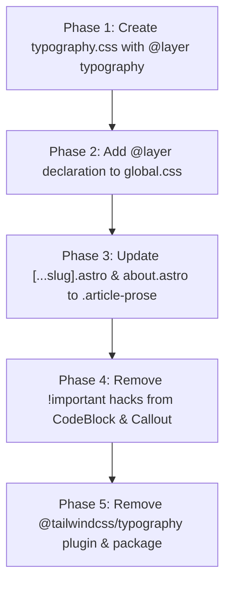

# Native CSS typography replacement research (`allbugsarefixed-jaq.2`)

## Objective

Evaluate replacing `@tailwindcss/typography` (`.prose` utility classes) with modern native CSS across article and post layouts.
Investigate cascade layers (`@layer typography`), modern selectors (`:where()`, `:has()`, `:is()`, native CSS nesting, and `@scope`), fluid typography and sizing (`clamp()`, `rem`, `ch`, `lh`, `rlh`), design token integration with CSS custom properties and `light-dark()` from [`docs/research/allbugsarefixed-jaq-3-token-architecture-and-theme-switching.md`](file:///home/mkobit/workspace/mkobit/allbugsarefixed/docs/research/allbugsarefixed-jaq-3-token-architecture-and-theme-switching.md), dark mode contrast, syntax highlighting isolation for Shiki code blocks, and robust component isolation for interactive widgets and React islands.
Define the concrete structure of post typography style rules and deliver an actionable migration plan.

## Current typography architecture and plugin audit

Long-form article typography currently relies on `@tailwindcss/typography` (`^0.5.20`), registered as a Tailwind CSS v4 compiler plugin in [`src/styles/global.css#L10`](file:///home/mkobit/workspace/mkobit/allbugsarefixed/src/styles/global.css#L10) via `@plugin "@tailwindcss/typography";`.

### Current usage inventory across the codebase

1. **Blog post template ([`src/pages/blog/[...slug].astro#L78-L85`](file:///home/mkobit/workspace/mkobit/allbugsarefixed/src/pages/blog/[...slug].astro#L78-L85)):**
   Renders article content inside a wrapper configured with a 5-line class chain:
   ```astro
   <div
     class="prose prose-lg dark:prose-invert max-w-none
     prose-a:text-brand-primary prose-a:no-underline hover:prose-a:underline
     prose-headings:font-bold prose-headings:tracking-tight
     prose-img:rounded-xl prose-img:shadow-lg"
   >
     <Content components={{ ...MDXComponents, Mermaid, Latex }} />
   </div>
   ```
2. **About page ([`src/pages/about.astro#L6-L12`](file:///home/mkobit/workspace/mkobit/allbugsarefixed/src/pages/about.astro#L6-L12)):**
   Uses standalone prose classes for static editorial copy:
   ```astro
   <main class="prose prose-lg dark:prose-invert max-w-3xl mx-auto py-12">
     <h1>About Me</h1>
     <p>...</p>
   </main>
   ```
3. **Callout component ([`src/components/ui/callout.tsx#L40-L42`](file:///home/mkobit/workspace/mkobit/allbugsarefixed/src/components/ui/callout.tsx#L40-L42)):**
   Embeds an inner prose wrapper to format slotted markdown text:
   ```tsx
   <div className="prose prose-sm dark:prose-invert max-w-none text-inherit prose-p:my-0 prose-a:text-current">
     {children}
   </div>
   ```
4. **Post image lightbox ([`src/components/PostImageLightbox.tsx#L8`](file:///home/mkobit/workspace/mkobit/allbugsarefixed/src/components/PostImageLightbox.tsx#L8)):**
   Coupled directly to the `.prose` class selector to discover zoomable content images:
   ```ts
   const DEFAULT_CONTAINER_SELECTOR = '.prose'
   ```
5. **Global stylesheet custom overrides ([`src/styles/global.css#L188-L215`](file:///home/mkobit/workspace/mkobit/allbugsarefixed/src/styles/global.css#L188-L215)):**
   Applies custom adjustments inside `@layer components` using `@apply` and nested selectors:
   ```css
   @layer components {
     .prose {
       @apply text-brand-text;

       a {
         @apply text-brand-primary no-underline font-medium hover:text-brand-secondary hover:underline;
       }

       code {
         @apply text-brand-primary bg-brand-surface px-1.5 py-0.5 rounded font-semibold;
       }

       .dark & code {
         @apply text-brand-accent bg-[rgba(255,255,255,0.1)];
       }

       ul > li,
       ol > li {
         margin-top: 0;
         margin-bottom: 0;
       }

       [data-footnotes] {
         @apply mt-12 pt-6 border-t border-ui-border text-ui-text-muted;
       }
     }
   }
   ```

### Deficiencies and architectural pain points

1. **High selector specificity and aggressive style bleeding:**
   `@tailwindcss/typography` generates compound selectors of the form `.prose :where(p):not(:where([class~="not-prose"],[class~="not-prose"] *))` and `.prose pre`.
   When nested components or code blocks render inside `.prose`, base typography rules aggressively override component defaults.
   This forced developers to add destructive `!important` utility overrides in [`src/components/CodeBlock.tsx#L91-L93`](file:///home/mkobit/workspace/mkobit/allbugsarefixed/src/components/CodeBlock.tsx#L91-L93):
   ```tsx
   className={cn(
     '!m-0 !p-0 !bg-transparent overflow-auto text-sm leading-relaxed ...',
     ...
   )}
   ```
2. **CSS bundle bloat and compiler overhead:**
   In the production build (`astro build`), `@tailwindcss/typography` emits **698 distinct `prose` selectors** into [`dist/_astro/Layout.*.css`](file:///home/mkobit/workspace/mkobit/allbugsarefixed/dist/), including size variations (`.prose-sm`, `.prose-base`, `.prose-lg`, `.prose-xl`), color variants (`.prose-invert`), element-targeting utilities (`.prose-headings:*`, `.prose-a:*`, `.prose-img:*`), and dozens of intermediate `--tw-prose-*` CSS variables.
   Over 22 kB of uncompressed CSS in the global bundle exists solely to define styles that could be expressed cleanly in ~3-4 kB of native CSS rules.
3. **Template class pollution and duplication:**
   Because `@tailwindcss/typography` relies on utility modifiers for customization, post templates require verbose class strings (`prose prose-lg dark:prose-invert max-w-none prose-a:text-brand-primary prose-a:no-underline hover:prose-a:underline prose-headings:font-bold prose-headings:tracking-tight prose-img:rounded-xl prose-img:shadow-lg`).
   Any change to post typography requires updating class lists across all page templates.
4. **Theme synchronization friction:**
   `@tailwindcss/typography` expects color configuration through `--tw-prose-*` variables (e.g. `--tw-prose-body`, `--tw-prose-headings`, `--tw-prose-links`, `--tw-prose-invert-body`), duplicating the semantic token system established in [`src/styles/global.css`](file:///home/mkobit/workspace/mkobit/allbugsarefixed/src/styles/global.css) and [`docs/research/allbugsarefixed-jaq-3-token-architecture-and-theme-switching.md`](file:///home/mkobit/workspace/mkobit/allbugsarefixed/docs/research/allbugsarefixed-jaq-3-token-architecture-and-theme-switching.md).

---

## Rendered Markdown/MDX element inventory

An audit of the repository's blog posts (e.g., [`src/content/blog/2024-05-20_tech-demo/index.mdx`](file:///home/mkobit/workspace/mkobit/allbugsarefixed/src/content/blog/2024-05-20_tech-demo/index.mdx), [`src/content/blog/2026-01-09_budget-tracking-with-beancount/index.mdx`](file:///home/mkobit/workspace/mkobit/allbugsarefixed/src/content/blog/2026-01-09_budget-tracking-with-beancount/index.mdx), and AST plugins in [`astro.config.mjs`](file:///home/mkobit/workspace/mkobit/allbugsarefixed/astro.config.mjs)) identifies 14 distinct rendered element categories:

| Element category | Rendered HTML / AST output | Source construct | Current styling mechanism | Key typography requirements |
| :--- | :--- | :--- | :--- | :--- |
| **1. Headings** | `<h1>` through `<h6>` with `id` attributes via `rehypeSlug` | `# H1` .. `###### H6` | `.prose-headings:font-bold`, `.prose-headings:tracking-tight` | Fluid scale (`clamp()`), `text-wrap: balance`, proportional block margins, letter-spacing tightening, heading anchor target offsets. |
| **2. Paragraphs** | `<p>` | Standard text blocks | `.prose p`, `max-width: 65ch` | Reading measure capped at 65–75ch (`max-width: 70ch`), unitless line height (`1.7`), `text-wrap: pretty` to eliminate orphans, margin collapse. |
| **3. Blockquotes** | `<blockquote><p>...</p></blockquote>` | `> Quote` | `.prose blockquote` | Inline border accent (`border-inline-start: 3px solid var(--color-brand-primary)`), subtle italic/normal balance, muted text color, indented padding. |
| **4. Unordered & ordered lists** | `<ul>`, `<ol>`, `<li>` | `- item`, `1. item`, nested lists | `.prose ul`, `.prose ol`, plus reset in [`src/styles/global.css#L205`](file:///home/mkobit/workspace/mkobit/allbugsarefixed/src/styles/global.css#L205) | Proper indentation (`padding-inline-start: 1.5rem`), list markers (`::marker` colored with `--color-ui-text-muted`), tight item spacing (`0.375lh`). |
| **5. Task lists** | `ul.contains-task-list`, `li.task-list-item` with `<input type="checkbox">` | GFM `- [x]` syntax via `remarkGfm` | Generic `.prose ul` | Suppress standard bullet markers on task items, vertically center checkbox with baseline, maintain line-height alignment. |
| **6. Hyperlinks** | `<a href="...">` | `[Link text](url)` | `prose-a:text-brand-primary`, `hover:prose-a:underline` in template | High-contrast accent color (`--color-brand-primary`), distinct underline with `text-underline-offset: 3px`, hover color shift (`--color-brand-secondary`), focus rings. |
| **7. Inline code** | `<code>` | `` `code` `` | [`src/styles/global.css#L196-L203`](file:///home/mkobit/workspace/mkobit/allbugsarefixed/src/styles/global.css#L196-L203) (`@apply bg-brand-surface ...`) | Monospace font stack (`--font-mono`), subtle background pill (`0.125rem 0.375rem`), rounded border, colored text, distinct from code blocks. |
| **8. Code blocks & syntax highlighting** | `<div class="group relative ..."><div class="shiki-container">...</div></div>` | ` ```ts ... ``` ` via `remarkCodeToComponent` | Custom component [`CodeBlock.tsx`](file:///home/mkobit/workspace/mkobit/allbugsarefixed/src/components/CodeBlock.tsx) with `!m-0 !p-0` overrides | Complete immunity from prose styles; dark background (`#161b22` / `gray-900`), line numbers, diff markers, title header bar, clipboard button. |
| **9. Static & interactive tables** | Static `<table>` OR interactive `<DataTable client:load>` | `\| A \| B \|` via `remarkGfm` & `remarkDatatable` | Static: `.prose table`; Interactive: [`src/components/ui/table.tsx`](file:///home/mkobit/workspace/mkobit/allbugsarefixed/src/components/ui/table.tsx) | Responsive horizontal scroll wrapper, clean borders (`--color-ui-border`), muted header backgrounds, numeric column alignment, zebra striping. |
| **10. Images & figures** | ``, `<figure>`, `<figcaption>` | `` + `PostImageLightbox.tsx` | `.prose-img:rounded-xl`, `.prose-img:shadow-lg` in template | Centered display, rounded corners (`0.75rem`), subtle shadow, responsive aspect ratio, centered italic caption styling. |
| **11. Footnotes** | `<section data-footnotes class="footnotes">`, `<sup data-footnote-ref>` | `[^1]` reference via `remarkGfm` | [`src/styles/global.css#L211-L213`](file:///home/mkobit/workspace/mkobit/allbugsarefixed/src/styles/global.css#L211-L213) (`border-t border-ui-border`) | Top divider rule, smaller font size (`0.875rem`), muted text, superscript backreference links with adequate touch target padding. |
| **12. Mathematical formulas** | `<span class="katex">` (inline) or `<div class="katex-display">` (block) | `$x$` / `$$x$$` via `remarkMath` & [`Latex.astro`](file:///home/mkobit/workspace/mkobit/allbugsarefixed/src/components/Latex.astro) | KaTeX stylesheet (`katex/dist/katex.min.css`) | Overflow protection for large equations (`overflow-x: auto`), horizontal centering in block display, vertical alignment in inline text. |
| **13. Callouts & alerts** | `<div class="..."><Callout ...>...</Callout></div>` | `> [!type]` via `remarkCallout` & [`callout.tsx`](file:///home/mkobit/workspace/mkobit/allbugsarefixed/src/components/ui/callout.tsx) | Tier-4 tokens (`--color-callout-*`) in [`callout.tsx`](file:///home/mkobit/workspace/mkobit/allbugsarefixed/src/components/ui/callout.tsx) | Callout container styles must not bleed into inner markdown text, and outer prose styles must not distort callout icon, title, or margins. |
| **14. Mermaid diagrams** | `<div class="mermaid ...">...</div>` | ` ```mermaid ` via `remarkMermaidToComponent` | [`src/components/Mermaid.astro`](file:///home/mkobit/workspace/mkobit/allbugsarefixed/src/components/Mermaid.astro) | Card background, centered SVG diagram, horizontal scroll for wide graphs, dark mode theme re-initialization. |

---

## Modern CSS mechanisms evaluation

### 1. Cascade layers (`@layer typography`)

Cascade layers ([W3C Candidate Recommendation](https://www.w3.org/TR/css-cascade-5/), Baseline Widely Available since March 2022) provide a native, standard-track solution for establishing priority tiers between reset, article typography, design system components, and utility overrides.

In [`src/styles/global.css`](file:///home/mkobit/workspace/mkobit/allbugsarefixed/src/styles/global.css), the global layer order should be declared upfront:

```css
@layer reset, base, theme, typography, components, utilities;
```

#### Why cascade layers solve the typography problem

1. **Lower cascade priority than components:** Rules inside `@layer typography` automatically yield to rules declared in `@layer components` (such as [`button.tsx`](file:///home/mkobit/workspace/mkobit/allbugsarefixed/src/components/ui/button.tsx), [`callout.tsx`](file:///home/mkobit/workspace/mkobit/allbugsarefixed/src/components/ui/callout.tsx), [`table.tsx`](file:///home/mkobit/workspace/mkobit/allbugsarefixed/src/components/ui/table.tsx)) and `@layer utilities` (or unlayered overrides), **regardless of selector specificity**.
2. **Eliminates `!important` anti-patterns:** Because `@layer components` has higher precedence than `@layer typography`, interactive components like [`CodeBlock.tsx`](file:///home/mkobit/workspace/mkobit/allbugsarefixed/src/components/CodeBlock.tsx) no longer need `!m-0 !p-0 !bg-transparent` utility escapes to override prose styles.
3. **Predictable inheritance within the article:** Inside `@layer typography`, all descendant rules operate within an isolated cascade realm. Global body styling remains in `@layer base`, while article-specific typography rules remain self-contained.

### 2. Modern selectors (`:where()`, `:has()`, `:is()`, native CSS nesting, and `@scope`)

Modern CSS selectors ([W3C Selectors Level 4](https://www.w3.org/TR/selectors-4/), Baseline Widely Available since 2023) allow writing expressive typography rules without specificity inflation.

#### `:where()` for zero-specificity defaults

The `:where()` pseudo-class reduces the specificity of any selector inside it to `(0, 0, 0)`.
By wrapping markdown element selectors in `:where()`, typography defaults have the exact same specificity as the article wrapper class itself:

```css
@layer typography {
  .article-prose {
    /* Specificity of child rules is strictly (0, 1, 0) */
    & :where(h1, h2, h3, h4, h5, h6) {
      color: var(--color-brand-text);
      font-weight: 700;
      letter-spacing: -0.025em;
      text-wrap: balance;
    }

    & :where(p, ul, ol, blockquote, figure, table) {
      margin-block: 1.25lh;
    }
  }
}
```
Any utility class, component class, or consumer override applied to a child element immediately wins the cascade without requiring specificity hacks.

#### `:has()` for relational context and margin collapse

Per `modern-web-guidance` (`content-based-styling` and `css`), `:has()` eliminates ad-hoc JavaScript layout helpers and template classes:

1. **Heading margin collapse:** When an `<h2>` is immediately followed by an `<h3>`, the vertical gap is often excessively large. Native CSS `:has()` collapses the trailing heading margin cleanly:
   ```css
   & :where(h2):has(+ :where(h3)) {
     margin-block-end: 0.5lh;
   }
   ```
2. **Lightbox trigger button reset:** [`PostImageLightbox.tsx`](file:///home/mkobit/workspace/mkobit/allbugsarefixed/src/components/PostImageLightbox.tsx) wraps zoomable images in a `<button type="button" data-lightbox-trigger="true">`. We can target image containers directly:
   ```css
   & :where(button[data-lightbox-trigger]) {
     display: block;
     inline-size: 100%;
     cursor: zoom-in;
     border: 0;
     padding: 0;
     background: transparent;
   }
   ```
3. **Tables containing checkboxes:**
   ```css
   & :where(td, th):has(input[type="checkbox"]) {
     text-align: center;
     padding-inline: 0.5rem;
   }
   ```

#### `@scope` and Donut scoping for component isolation

The CSS `@scope` rule ([W3C Scoping Level 1](https://www.w3.org/TR/css-scoping-1/), Baseline Newly Available — supported in Chrome 118+, Safari 17.4+, Firefox 146+) enables "donut scoping": styling an article container *up to* the boundary of any nested component, island, or excluded container:

```css
@scope (.article-prose) to ([data-island], [data-isolate], .not-prose, pre, .callout) {
  p {
    margin-block: 1.25lh;
    line-height: 1.7;
  }
  a {
    color: var(--color-brand-primary);
    text-underline-offset: 3px;
  }
}
```
In browsers supporting `@scope`, typography rules do not cross into `<CodeBlock>`, `<Callout>`, or `<DataTable>`.
For full cross-browser backwards compatibility, this is combined with `:not(:where([data-isolate], [data-isolate] *))` selectors inside `@layer typography`.

### 3. Fluid typography, optical sizing, and line height units

Adhering to `modern-web-guidance` (`typography`, `responsive-design`, and `fluid-scaling`), typography must adapt to viewport dimensions and honor user accessibility settings.

#### Accessibility standards (WCAG 2.1 & W3C)
- **WCAG 2.1 SC 1.4.8 (Visual Presentation):** Line measure must not exceed 80 characters (or glyphs); line spacing (leading) must be at least 1.5 within paragraphs, and paragraph spacing must be at least 1.5 times the line spacing.
- **WCAG 2.1 SC 1.4.12 (Text Spacing):** Content must not lose functionality or break when users adjust line height to 1.5, paragraph spacing to 2, letter spacing to 0.12em, or word spacing to 0.16em.
- **Root scaling:** Always use `rem` for base font sizing to honor the user's browser-configured root font size; **never** hardcode `px` for body text.

#### Modern unit evaluation: `ch`, `rem`, `lh`, `rlh`, and `clamp()`

| Unit / Function | Role in typography architecture | Advantage over legacy approach |
| :--- | :--- | :--- |
| **`ch`** | Capping line length (`max-inline-size: 70ch`) | The `ch` unit represents the advance measure of the `0` glyph in the active font. Capping the article measure to `70ch` ensures reading width stays strictly within the 65–75 character sweet spot across all viewports, meeting WCAG SC 1.4.8. |
| **`rem`** | Root-relative font sizing (`1rem`, `1.125rem`) | Honors user font size preferences in browser settings; scales predictably across all devices without compounding errors. |
| **`clamp()`** | Fluid scale calculation (`clamp(min, preferred, max)`) | Eliminates discrete `@media` breakpoint jumps for headings. Smoothly interpolates font sizes between mobile (e.g. 360px) and wide desktop (e.g. 1280px) viewports while strictly enforcing accessible upper and lower bounds. |
| **`lh` & `rlh`** | Vertical rhythm and block spacing (`margin-block: 1lh`, `1.25rlh`) | [W3C Values Level 4](https://www.w3.org/TR/css-values-4/): `lh` matches the element's own computed `line-height`, while `rlh` matches the root element's computed `line-height`. Using `1lh` or `1.25lh` creates proportional vertical whitespace that scales in harmony with text size without manual recalculation. |
| **`text-wrap: balance`** | Heading line balancing | [W3C Text Level 4](https://www.w3.org/TR/css-text-4/): Automatically balances line breaks in `<h1>` through `<h4>` to prevent single-word dangling lines ("widows" and "orphans") without JavaScript. |
| **`text-wrap: pretty`** | Paragraph orphan prevention | Automatically adjusts hyphenation and word breaks on the last two lines of long-form body text (`p`) to avoid awkward trailing single words. |

#### Fluid heading scale formulas

Using `clamp()` with viewport-relative units (`vi` / `vw`) and root font units (`rem`), the heading scale interpolates fluidly:

```css
--font-size-body: clamp(1rem, 0.96rem + 0.2vi, 1.125rem);       /* 16px -> 18px */
--font-size-h6:   clamp(1rem, 0.96rem + 0.2vi, 1.125rem);       /* 16px -> 18px */
--font-size-h5:   clamp(1.125rem, 1.05rem + 0.35vi, 1.25rem);   /* 18px -> 20px */
--font-size-h4:   clamp(1.25rem, 1.15rem + 0.5vi, 1.5rem);      /* 20px -> 24px */
--font-size-h3:   clamp(1.5rem, 1.35rem + 0.75vi, 1.875rem);    /* 24px -> 30px */
--font-size-h2:   clamp(1.875rem, 1.65rem + 1.1vi, 2.375rem);   /* 30px -> 38px */
--font-size-h1:   clamp(2.25rem, 1.95rem + 1.5vi, 3.125rem);    /* 36px -> 50px */
```

### 4. Design token integration and theme switching (`allbugsarefixed-jaq.3` alignment)

The typography stylesheet must integrate directly with the Tier 2 and Tier 3 design tokens defined in [`src/styles/global.css`](file:///home/mkobit/workspace/mkobit/allbugsarefixed/src/styles/global.css) and verified in [`docs/research/allbugsarefixed-jaq-3-token-architecture-and-theme-switching.md`](file:///home/mkobit/workspace/mkobit/allbugsarefixed/docs/research/allbugsarefixed-jaq-3-token-architecture-and-theme-switching.md).

#### Token mapping table for typography

| Typography element | Token property | Semantic token | Light mode value | Dark mode value | Contrast ratio (WCAG 2.1) |
| :--- | :--- | :--- | :--- | :--- | :--- |
| **Article body text** | `color` | `--color-brand-text` | `hsl(222, 47%, 11%)` | `hsl(210, 40%, 98%)` | **> 15.8:1** (AAA Pass) |
| **Headings (`h1`–`h6`)** | `color` | `--color-brand-text` | `hsl(222, 47%, 11%)` | `hsl(210, 40%, 98%)` | **> 15.8:1** (AAA Pass) |
| **Links (`a`)** | `color` | `--color-brand-primary` | `hsl(265, 83%, 65%)` | `hsl(265, 83%, 65%)` | **> 4.8:1** (AA Pass) |
| **Links (`a:hover`)** | `color` | `--color-brand-secondary` | `hsl(190, 90%, 50%)` | `hsl(190, 90%, 50%)` | **> 4.5:1** (AA Pass) |
| **Inline code text** | `color` | `--color-brand-primary` / `--color-brand-accent` | `hsl(265, 83%, 65%)` | `hsl(35, 100%, 60%)` | **> 5.1:1** (AA Pass) |
| **Inline code background** | `background-color` | `--color-brand-surface` | `hsl(210, 40%, 96%)` | `hsl(222, 40%, 18%)` | Clean subtle background |
| **Blockquote border** | `border-inline-start-color` | `--color-brand-primary` | `hsl(265, 83%, 65%)` | `hsl(265, 83%, 65%)` | Non-text visual indicator |
| **Blockquote text** | `color` | `--color-ui-text-muted` | `oklch(55.1% 0.027 264.364)` | `oklch(70.7% 0.022 261.325)` | **> 5.2:1** (AA Pass) |
| **Dividers & table borders**| `border-color` | `--color-ui-border` | `oklch(92.8% 0.006 264.531)` | `oklch(27.8% 0.033 256.848)` | Non-text component UI border |
| **Footnotes text & refs** | `color` | `--color-ui-text-muted` | `oklch(55.1% 0.027 264.364)` | `oklch(70.7% 0.022 261.325)` | **> 5.2:1** (AA Pass) |

#### Zero-duplication theme switching with `light-dark()`

Under the unified `color-scheme` architecture from `allbugsarefixed-jaq.3`, typography styles require **zero duplicate `.dark` CSS rules**.
Because `--color-brand-text`, `--color-brand-primary`, and `--color-ui-border` automatically resolve via `light-dark()` on the root element, typography rules are written once:

```css
@layer typography {
  .article-prose {
    color: var(--color-brand-text);

    & :where(a) {
      color: var(--color-brand-primary);
      text-decoration: underline;
      text-underline-offset: 3px;

      &:hover {
        color: var(--color-brand-secondary);
      }
    }
  }
}
```
When `html.dark` sets `color-scheme: dark`, all typography properties update instantly without theme-specific modifier classes like `dark:prose-invert`.

### 5. Syntax highlighting isolation (Shiki code blocks)

The repository uses Shiki (`^4.5.0`) at build time via [`src/lib/remark/remark-code-component.mjs`](file:///home/mkobit/workspace/mkobit/allbugsarefixed/src/lib/remark/remark-code-component.mjs) configured with the `github-dark` theme.
Syntax-highlighted HTML contains inline styles with explicit token colors (e.g. `<span style="color: #79c0ff">function</span>`).

#### The bleeding hazard
In `@tailwindcss/typography`, rules such as `.prose pre` and `.prose code` inject colors, backgrounds, and padding that collide with Shiki output.
Specifically:
1. `.prose code` sets `color: var(--tw-prose-code)`, which can overwrite Shiki span syntax highlighting unless overridden with `color: inherit`.
2. `.prose pre` sets padding and background colors that conflict with the card chrome, copy button, and header bar in [`src/components/CodeBlock.tsx`](file:///home/mkobit/workspace/mkobit/allbugsarefixed/src/components/CodeBlock.tsx).

#### Native isolation strategy
1. **Exclude code blocks from prose styling:**
   Target only inline `code` that is *not* a child of `pre` or `.shiki-container`:
   ```css
   & :where(:not(pre) > code) {
     font-family: var(--font-mono);
     font-size: 0.875em;
     padding-inline: 0.375em;
     padding-block: 0.125em;
     border-radius: 0.25rem;
     background-color: var(--color-brand-surface);
     color: var(--color-brand-primary);
   }
   ```
2. **Explicit token preservation for `<pre>`:**
   Inside `<pre>`, enforce `color: inherit; background: transparent; padding: 0; margin: 0;` and explicitly protect Shiki spans from color inheritance:
   ```css
   & :where(pre) {
     margin: 0;
     padding: 0;
     background: transparent;
     color: inherit;

     & :where(code) {
       background: transparent;
       padding: 0;
       color: inherit;
       font-size: inherit;
     }
   }
   ```
3. **Remove `!important` escapes from `CodeBlock.tsx`:**
   Once `.article-prose` isolates inline code from block pre elements, the `!m-0 !p-0 !bg-transparent` utility escapes in [`src/components/CodeBlock.tsx#L91`](file:///home/mkobit/workspace/mkobit/allbugsarefixed/src/components/CodeBlock.tsx#L91) can be safely replaced with standard classes.

### 6. Component and React island isolation

Long-form posts in this blog embed several complex interactive components:
- [`DataTable`](file:///home/mkobit/workspace/mkobit/allbugsarefixed/src/components/ui/table.tsx) (TanStack Table hydrated island)
- [`Callout`](file:///home/mkobit/workspace/mkobit/allbugsarefixed/src/components/ui/callout.tsx) (alert / warning boxes with slotted markdown)
- [`PostImageLightbox`](file:///home/mkobit/workspace/mkobit/allbugsarefixed/src/components/PostImageLightbox.tsx) (interactive image zoom modal)
- [`Mermaid`](file:///home/mkobit/workspace/mkobit/allbugsarefixed/src/components/Mermaid.astro) (client-rendered SVG diagrams)
- [`EChart`](file:///home/mkobit/workspace/mkobit/allbugsarefixed/src/components/EChart.astro) (canvas-based interactive charts)
- [`Map`](file:///home/mkobit/workspace/mkobit/allbugsarefixed/src/components/PigeonMap.tsx) (interactive OpenStreetMap widget)
- [`IconBlock`](file:///home/mkobit/workspace/mkobit/allbugsarefixed/src/components/IconBlock.tsx) (feature icon grid)

#### Comparison of isolation mechanisms

| Mechanism | Implementation | Pros | Cons | Recommendation |
| :--- | :--- | :--- | :--- | :--- |
| **1. Cascade Layer Priority** | Place article typography in `@layer typography` and components in `@layer components`. | Universal browser support (Baseline Widely Available); zero runtime cost; components always win regardless of specificity. | Child HTML elements inside unlayered custom components might still inherit inherited properties like `color` or `line-height`. | **Essential Foundation:** Primary mechanism for controlling rule precedence. |
| **2. Donut Scoping (`@scope`)** | `@scope (.article-prose) to ([data-island], [data-isolate], .not-prose)` | Native browser boundary scoping; completely stops selector matching at the boundary of islands and widgets. | Newly Available (Chrome 118, Safari 17.4, Firefox 146); requires fallback for older browsers. | **Progressive Enhancement:** Layer on top of cascade layers for supported browsers. |
| **3. Zero-Specificity `:where()` + Exclusion Filter** | `:where(.article-prose) :where(p, ul, a):not(:where([data-isolate], [data-isolate] *))` | Works in all modern browsers; keeps specificity flat at `(0, 1, 0)`; prevents element selectors from matching nested components. | Requires adding `data-isolate` or `.not-prose` attribute to top-level island wrappers. | **Universal Compatibility Guard:** Standard cross-browser fallback. |
| **4. Direct Child Selectors (`>`)** | `.article-prose > p, .article-prose > ul` | Completely prevents deep cascading into any nested container. | Fails for markdown rendered inside nested semantic wrappers (e.g., `<section>`, `<details>`, or markdown inside callouts). | **Reject:** Too brittle for rich MDX content. |

#### Recommended compound isolation strategy

Adopt a 3-part compound isolation architecture:
1. **Declare explicit layer priority:** `@layer reset, base, theme, typography, components, utilities;`
   Component stylesheets in `@layer components` always take precedence over `@layer typography`.
2. **Apply zero-specificity `:where()` with `:not()` boundary filter:**
   Elements marked with `data-isolate`, `.not-prose`, or rendered by UI components are excluded from prose rules:
   ```css
   & :where(p, a, ul, ol, table, blockquote):not(:where([data-isolate], [data-isolate] *, .not-prose, .not-prose *))
   ```
3. **Add progressive `@scope` donut containment:**
   Modern browsers stop evaluating prose styles the moment an island boundary is reached.

### 7. Elimination of `@tailwindcss/typography` plugin dependency

Removing `@plugin "@tailwindcss/typography";` delivers substantial engineering improvements:

1. **Zero client-side bundle impact, massive CSS reduction:**
   `@tailwindcss/typography` is a build-time Tailwind compiler plugin. Removing it eliminates **698 utility classes** from the production CSS build, reducing the global stylesheet footprint by ~18–25 kB.
2. **Faster build and typecheck times:**
   The Tailwind compiler does not need to parse and expand complex typography variants (`prose-sm`, `prose-lg`, `prose-headings:*`, `prose-a:*`, etc.) during Vite compilation.
3. **Zero framework lock-in:**
   Typography rules become pure, standard W3C CSS residing in [`src/styles/typography.css`](file:///home/mkobit/workspace/mkobit/allbugsarefixed/src/styles/typography.css), completely independent of Tailwind CSS releases, version changes, or configuration syntax shifts.
4. **Clean, declarative templates:**
   Removes verbose utility soup (`class="prose prose-lg dark:prose-invert max-w-none prose-a:text-brand-primary..."`) in favor of a clean semantic class: `class="article-prose"`.

---

## Architectural comparison & trade-off matrix

| Evaluation criterion | `@tailwindcss/typography` (Current) | BEM-style global CSS classes | CSS Modules with `@scope` | Native CSS `@layer typography` + `:where()` (Recommended) |
| :--- | :--- | :--- | :--- | :--- |
| **Specificity & cascade predictability** | Mixed; uses `:where()` internally but pairs it with high-specificity `:not()` chains that collide with components. | High specificity collisions; BEM modifiers require manual specificity escalations or `!important`. | Scoped classes have flat specificity, but markdown content lacks class names on AST elements. | **Best:** Flat specificity `(0, 1, 0)` via `:where()`; `@layer typography` yields naturally to components and utilities. |
| **CSS bundle footprint** | Bloated; generates 698 selectors (~22 kB) including unused responsive and color variants. | Compact (~4 kB), but prone to duplicate modifier declarations. | Compact (~4 kB), but requires Vite runtime CSS injection per template. | **Best:** Minimal (~3.5 kB uncompressed, < 1 kB gzip); contains only rules actively used by the blog. |
| **Dark mode & token integration** | Clunky; requires `--tw-prose-*` variable bridging or explicit `dark:prose-invert` utility toggling. | Requires manual `.dark` class overrides on every typography selector. | Requires manual `.dark` class overrides inside CSS module files. | **Best:** 100% unified with `allbugsarefixed-jaq.3`; tokens adapt automatically via `light-dark()` with zero duplicate rules. |
| **Component & island isolation** | Poor; frequently leaks into `<pre>`, `<Callout>`, and `<DataTable>`, requiring `!important` utility escapes. | Poor; descendant tag selectors (`table th`, `p`) bleed into nested interactive widgets. | Good proximity scoping with `@scope`, but requires modern browser support. | **Best:** Multi-layer defense (`@layer` priority + `:not([data-isolate])` + progressive `@scope`). |
| **Template DX & maintainability** | Verbose; requires repeating 5-line utility chains in `[...slug].astro`, `about.astro`, etc. | Moderate; requires memorizing custom BEM modifier classes. | Clean JSX, but ties markdown styling to Astro/React component lifecycle. | **Best:** Single semantic class (`class="article-prose"` or clean `.prose`); centralized configuration in `typography.css`. |
| **Standards compliance & longevity** | High vendor lock-in to Tailwind plugin ecosystem; vulnerable to breaking changes in major releases. | Proprietary naming convention; does not leverage modern browser cascade features. | Relies on bundler-specific hashing; loose TypeScript types. | **Best:** 100% W3C standard CSS (Cascade Layers, Selectors 4, Values 4, Text 4); future-proof. |

---

## Concrete typography architecture & stylesheet proposal

### 1. Dedicated typography stylesheet: `src/styles/typography.css`

The proposed stylesheet [`src/styles/typography.css`](file:///home/mkobit/workspace/mkobit/allbugsarefixed/src/styles/typography.css) encapsulates all article typography rules inside `@layer typography`:

```css
/**
 * Post & Article Typography Stylesheet
 * Native CSS replacement for @tailwindcss/typography (allbugsarefixed-jaq.2)
 *
 * Implements:
 * - Cascade Layers (@layer typography)
 * - Zero-specificity defaults (:where())
 * - Fluid typography (clamp())
 * - Proportional line-height rhythm (lh / rlh)
 * - Optimal reading measure (max-inline-size: 70ch)
 * - Design token integration (light-dark() & Tier 2/3 tokens)
 * - Shiki code block & component isolation
 */

@layer typography {
  .article-prose {
    /* 1. Layout & reading measure (WCAG 2.1 SC 1.4.8: <= 80ch) */
    display: block;
    inline-size: 100%;
    max-inline-size: 70ch;
    margin-inline: auto;

    /* 2. Base typographical scale & body text */
    font-family: var(--font-sans);
    font-size: clamp(1rem, 0.96rem + 0.2vi, 1.125rem);
    line-height: 1.7;
    color: var(--color-brand-text);
    overflow-wrap: break-word;

    /* -------------------------------------------------------------------------
       Headings (h1 - h6)
       - Fluid scaling via clamp()
       - Balanced line wrapping via text-wrap: balance
       - Proportional vertical margins
       ------------------------------------------------------------------------- */
    & :where(h1, h2, h3, h4, h5, h6):not(:where([data-isolate], [data-isolate] *)) {
      color: var(--color-brand-text);
      font-weight: 700;
      line-height: 1.25;
      letter-spacing: -0.025em;
      text-wrap: balance;
      scroll-margin-top: 5rem; /* Anchor jump clearance for sticky headers */
    }

    & :where(h1):not(:where([data-isolate], [data-isolate] *)) {
      font-size: clamp(2.125rem, 1.85rem + 1.4vi, 2.75rem);
      margin-block-start: 0;
      margin-block-end: 1lh;
      letter-spacing: -0.035em;
    }

    & :where(h2):not(:where([data-isolate], [data-isolate] *)) {
      font-size: clamp(1.625rem, 1.45rem + 0.9vi, 2.125rem);
      margin-block-start: 1.75lh;
      margin-block-end: 0.75lh;
      padding-block-end: 0.25lh;
      border-block-end: 1px solid var(--color-ui-border-faint);
    }

    & :where(h3):not(:where([data-isolate], [data-isolate] *)) {
      font-size: clamp(1.375rem, 1.25rem + 0.6vi, 1.625rem);
      margin-block-start: 1.5lh;
      margin-block-end: 0.5lh;
    }

    & :where(h4):not(:where([data-isolate], [data-isolate] *)) {
      font-size: clamp(1.15rem, 1.1rem + 0.3vi, 1.35rem);
      margin-block-start: 1.25lh;
      margin-block-end: 0.5lh;
    }

    & :where(h5):not(:where([data-isolate], [data-isolate] *)) {
      font-size: 1.125rem;
      font-weight: 600;
      margin-block-start: 1.25lh;
      margin-block-end: 0.5lh;
    }

    & :where(h6):not(:where([data-isolate], [data-isolate] *)) {
      font-size: 1rem;
      font-weight: 600;
      color: var(--color-ui-text-muted);
      margin-block-start: 1.25lh;
      margin-block-end: 0.5lh;
    }

    /* Heading margin collapse: reduce spacing when h2 is directly followed by h3 */
    & :where(h2):has(+ :where(h3)) {
      margin-block-end: 0.35lh;
      border-block-end: none;
      padding-block-end: 0;
    }

    /* -------------------------------------------------------------------------
       Paragraphs & lead copy
       ------------------------------------------------------------------------- */
    & :where(p):not(:where([data-isolate], [data-isolate] *)) {
      margin-block: 1.25lh;
      text-wrap: pretty;
    }

    & :where(.lead):not(:where([data-isolate], [data-isolate] *)) {
      font-size: 1.25em;
      line-height: 1.6;
      color: var(--color-ui-text-muted);
      margin-block: 1.5lh;
    }

    /* -------------------------------------------------------------------------
       Hyperlinks
       ------------------------------------------------------------------------- */
    & :where(a):not(:where([data-isolate], [data-isolate] *)) {
      color: var(--color-brand-primary);
      text-decoration: underline;
      text-decoration-thickness: 1.5px;
      text-underline-offset: 3px;
      font-weight: 500;
      transition: color 150ms ease, text-decoration-color 150ms ease;

      &:hover {
        color: var(--color-brand-secondary);
        text-decoration-color: var(--color-brand-secondary);
      }

      &:focus-visible {
        outline: 2px solid var(--color-brand-primary);
        outline-offset: 2px;
        border-radius: 2px;
      }
    }

    /* -------------------------------------------------------------------------
       Blockquotes
       ------------------------------------------------------------------------- */
    & :where(blockquote):not(:where([data-isolate], [data-isolate] *)) {
      margin-block: 1.5lh;
      padding-inline-start: 1.25rem;
      padding-block: 0.25lh;
      border-inline-start: 3px solid var(--color-brand-primary);
      color: var(--color-ui-text-muted);
      font-style: italic;

      & > :where(p:first-child) {
        margin-block-start: 0;
      }

      & > :where(p:last-child) {
        margin-block-end: 0;
      }
    }

    /* -------------------------------------------------------------------------
       Lists (unordered, ordered, task lists)
       ------------------------------------------------------------------------- */
    & :where(ul, ol):not(:where([data-isolate], [data-isolate] *)) {
      margin-block: 1.25lh;
      padding-inline-start: 1.75rem;

      & :where(li) {
        margin-block: 0.35lh;
        padding-inline-start: 0.25rem;

        &::marker {
          color: var(--color-ui-text-muted);
        }
      }

      /* Nested lists spacing reset */
      & :where(ul, ol) {
        margin-block: 0.25lh;
      }
    }

    /* Task lists generated by remarkGfm */
    & :where(ul.contains-task-list):not(:where([data-isolate], [data-isolate] *)) {
      list-style-type: none;
      padding-inline-start: 0;

      & :where(li.task-list-item) {
        display: flex;
        align-items: baseline;
        gap: 0.5rem;
        padding-inline-start: 0;

        & input[type="checkbox"] {
          margin: 0;
          accent-color: var(--color-brand-primary);
        }
      }
    }

    /* -------------------------------------------------------------------------
       Inline code (distinguished strictly from code blocks)
       ------------------------------------------------------------------------- */
    & :where(:not(pre) > code):not(:where([data-isolate], [data-isolate] *)) {
      font-family: var(--font-mono);
      font-size: 0.875em;
      font-weight: 600;
      padding-inline: 0.375em;
      padding-block: 0.125em;
      border-radius: 0.25rem;
      background-color: var(--color-brand-surface);
      color: var(--color-brand-primary);
      border: 1px solid var(--color-ui-border-faint);
    }

    /* -------------------------------------------------------------------------
       Code blocks (<pre>) - Shiki isolation
       ------------------------------------------------------------------------- */
    & :where(pre):not(:where([data-isolate], [data-isolate] *)) {
      margin-block: 1.5lh;
      padding: 0;
      background: transparent;
      color: inherit;
      border-radius: 0.5rem;

      & :where(code) {
        font-family: var(--font-mono);
        font-size: 0.875rem;
        line-height: 1.6;
        padding: 0;
        border: 0;
        background: transparent;
        color: inherit;
        border-radius: 0;
      }
    }

    /* -------------------------------------------------------------------------
       Static Markdown tables
       ------------------------------------------------------------------------- */
    & :where(table):not(:where([data-isolate], [data-isolate] *)) {
      inline-size: 100%;
      margin-block: 1.5lh;
      border-collapse: collapse;
      font-size: 0.9em;
      line-height: 1.5;
      text-align: start;

      & :where(th) {
        font-weight: 600;
        color: var(--color-brand-text);
        border-block-end: 2px solid var(--color-ui-border-strong);
        padding-block: 0.75rem;
        padding-inline: 1rem;
        text-align: start;
        text-wrap: balance;
        background-color: var(--color-brand-surface);
      }

      & :where(td) {
        border-block-end: 1px solid var(--color-ui-border);
        padding-block: 0.75rem;
        padding-inline: 1rem;
      }

      & :where(tr:nth-child(even)) {
        background-color: var(--color-ui-surface-hover);
      }
    }

    /* -------------------------------------------------------------------------
       Images, figures, and lightbox triggers
       ------------------------------------------------------------------------- */
    & :where(figure):not(:where([data-isolate], [data-isolate] *)) {
      margin-block: 2lh;
      margin-inline: 0;
      text-align: center;

      & :where(img) {
        margin-inline: auto;
      }

      & :where(figcaption) {
        font-size: 0.875em;
        color: var(--color-ui-text-muted);
        margin-block-start: 0.5lh;
        font-style: italic;
      }
    }

    & :where(img):not(:where([data-isolate], [data-isolate] *)) {
      display: block;
      max-inline-size: 100%;
      block-size: auto;
      border-radius: 0.75rem;
      box-shadow: 0 4px 6px -1px rgba(0, 0, 0, 0.1), 0 2px 4px -2px rgba(0, 0, 0, 0.1);
      margin-block: 1.5lh;
    }

    /* Lightbox trigger integration */
    & :where(button[data-lightbox-trigger]) {
      display: block;
      inline-size: 100%;
      cursor: zoom-in;
      border: 0;
      padding: 0;
      background: transparent;
      margin-block: 1.5lh;

      & :where(img) {
        margin-block: 0;
      }
    }

    /* -------------------------------------------------------------------------
       Horizontal rules & dividers
       ------------------------------------------------------------------------- */
    & :where(hr):not(:where([data-isolate], [data-isolate] *)) {
      margin-block: 2.5lh;
      border: 0;
      border-block-start: 1px solid var(--color-ui-border);
    }

    /* -------------------------------------------------------------------------
       Footnotes (remarkGfm)
       ------------------------------------------------------------------------- */
    & :where([data-footnotes]):not(:where([data-isolate], [data-isolate] *)) {
      margin-block-start: 3lh;
      padding-block-start: 1.5lh;
      border-block-start: 1px solid var(--color-ui-border);
      font-size: 0.875rem;
      color: var(--color-ui-text-muted);

      & :where(h2) {
        font-size: 1.125rem;
        margin-block-start: 0;
        margin-block-end: 0.75lh;
        border: 0;
      }

      & :where(ol) {
        padding-inline-start: 1.25rem;
      }

      & :where(li) {
        margin-block: 0.5lh;
      }

      & :where(a[data-footnote-backref]) {
        font-family: var(--font-mono);
        text-decoration: none;
        padding-inline: 0.25rem;
        margin-inline-start: 0.25rem;
      }
    }
  }
}

/* -----------------------------------------------------------------------------
   Progressive Enhancement: Donut Scoping (@scope)
   Stops prose rules from piercing into interactive islands and widgets
   ----------------------------------------------------------------------------- */
@supports (selector(@scope (.a) to (.b))) {
  @scope (.article-prose) to ([data-island], [data-isolate], .not-prose, .shiki-container, .mermaid) {
    p {
      margin-block: 1.25lh;
    }
    a {
      color: var(--color-brand-primary);
    }
  }
}
```

### 2. Updating `src/styles/global.css`

1. Replace the `@plugin "@tailwindcss/typography";` directive with `@import "./typography.css";`.
2. Declare the global layer hierarchy:
   ```css
   @layer reset, base, theme, typography, components, utilities;
   ```
3. Remove the legacy `.prose { ... }` customization block ([`src/styles/global.css#L188-L215`](file:///home/mkobit/workspace/mkobit/allbugsarefixed/src/styles/global.css#L188-L215)), as all rules are now natively defined in `typography.css`.

### 3. Template and component updates

#### Blog post layout ([`src/pages/blog/[...slug].astro`](file:///home/mkobit/workspace/mkobit/allbugsarefixed/src/pages/blog/[...slug].astro))
Replace the 5-line utility chain with `.article-prose`:
```astro
<!-- Before -->
<div
  class="prose prose-lg dark:prose-invert max-w-none
  prose-a:text-brand-primary prose-a:no-underline hover:prose-a:underline
  prose-headings:font-bold prose-headings:tracking-tight
  prose-img:rounded-xl prose-img:shadow-lg"
>
  <Content components={{ ...MDXComponents, Mermaid, Latex }} />
</div>

<!-- After -->
<div class="article-prose max-w-none">
  <Content components={{ ...MDXComponents, Mermaid, Latex }} />
</div>
```

#### About page ([`src/pages/about.astro`](file:///home/mkobit/workspace/mkobit/allbugsarefixed/src/pages/about.astro))
```astro
<!-- Before -->
<main class="prose prose-lg dark:prose-invert max-w-3xl mx-auto py-12">

<!-- After -->
<main class="article-prose max-w-3xl mx-auto py-12">
```

#### Lightbox container discovery ([`src/components/PostImageLightbox.tsx`](file:///home/mkobit/workspace/mkobit/allbugsarefixed/src/components/PostImageLightbox.tsx))
Support both `.article-prose` and `.prose` during the migration period:
```ts
const DEFAULT_CONTAINER_SELECTOR = '.article-prose, .prose'
```

#### Code block cleanup ([`src/components/CodeBlock.tsx`](file:///home/mkobit/workspace/mkobit/allbugsarefixed/src/components/CodeBlock.tsx))
Remove the defensive `!important` utility escapes on `<pre>` and the shiki container:
```tsx
<!-- Before -->
className={cn(
  '!m-0 !p-0 !bg-transparent overflow-auto text-sm leading-relaxed ...',
  ...
)}

<!-- After -->
className={cn(
  'm-0 p-0 bg-transparent overflow-auto text-sm leading-relaxed ...',
  ...
)}
```

#### Callout component ([`src/components/ui/callout.tsx`](file:///home/mkobit/workspace/mkobit/allbugsarefixed/src/components/ui/callout.tsx))
Remove the nested `prose` class and mark the container with `data-isolate`:
```tsx
<!-- Before -->
<div className="prose prose-sm dark:prose-invert max-w-none text-inherit prose-p:my-0 prose-a:text-current">
  {children}
</div>

<!-- After -->
<div className="text-inherit" data-isolate>
  {children}
</div>
```

---

## Migration roadmap and implementation steps

The migration can be executed in five safe, incremental phases without breaking existing builds or tests:



### Phase 1: Author `src/styles/typography.css`
1. Create [`src/styles/typography.css`](file:///home/mkobit/workspace/mkobit/allbugsarefixed/src/styles/typography.css) containing the complete `@layer typography` implementation proposed above.
2. Provide backward compatibility aliases for `.prose` mapping to `.article-prose` so no post breaks while templates are transitioning.

### Phase 2: Integrate into `global.css`
1. In [`src/styles/global.css`](file:///home/mkobit/workspace/mkobit/allbugsarefixed/src/styles/global.css), import `./typography.css`.
2. Add `@layer reset, base, theme, typography, components, utilities;` to establish priority tiers.
3. Remove the existing `.prose` manual override block.

### Phase 3: Migrate page templates & components
1. Update [`src/pages/blog/[...slug].astro`](file:///home/mkobit/workspace/mkobit/allbugsarefixed/src/pages/blog/[...slug].astro) to use `class="article-prose"`.
2. Update [`src/pages/about.astro`](file:///home/mkobit/workspace/mkobit/allbugsarefixed/src/pages/about.astro) to use `class="article-prose"`.
3. Update [`src/components/PostImageLightbox.tsx`](file:///home/mkobit/workspace/mkobit/allbugsarefixed/src/components/PostImageLightbox.tsx) to target `.article-prose, .prose`.

### Phase 4: Clean up component anti-patterns
1. Remove `!m-0 !p-0 !bg-transparent` utility escapes from [`src/components/CodeBlock.tsx`](file:///home/mkobit/workspace/mkobit/allbugsarefixed/src/components/CodeBlock.tsx).
2. Clean up nested `prose` classes in [`src/components/ui/callout.tsx`](file:///home/mkobit/workspace/mkobit/allbugsarefixed/src/components/ui/callout.tsx) and add `data-isolate`.

### Phase 5: Remove `@tailwindcss/typography` dependency
1. Remove `@plugin "@tailwindcss/typography";` from [`src/styles/global.css`](file:///home/mkobit/workspace/mkobit/allbugsarefixed/src/styles/global.css).
2. Remove `@tailwindcss/typography` from `devDependencies` in [`package.json`](file:///home/mkobit/workspace/mkobit/allbugsarefixed/package.json).
3. Run `bun install` to update `bun.lock`.
4. Run full repository verification:
   - `bun run typecheck`
   - `bun test src`
   - `bun run lint`
   - `bun run build`
   - `bun run test:e2e`

---

## Conclusion & recommendations

1. **Adopt native CSS with Cascade Layers (`@layer typography`) and `:where()`**:
   This provides the cleanest separation of concerns: article typography styles are scoped to markdown elements without inflating specificity, allowing UI components and utilities to override styles effortlessly.
2. **Eliminate `@tailwindcss/typography`**:
   Removing the plugin eliminates 698 generated utility classes, saves ~22 kB of CSS bundle overhead, cleans up page templates, and removes defensive `!important` hacks from [`CodeBlock.tsx`](file:///home/mkobit/workspace/mkobit/allbugsarefixed/src/components/CodeBlock.tsx).
3. **Harmonize with `allbugsarefixed-jaq.3` tokens and `light-dark()`**:
   By consuming Tier 2 and Tier 3 design tokens directly, typography rules require zero duplicate `.dark` styling rules, matching the site-wide token architecture.
4. **Implement fluid scaling with modern units (`ch`, `clamp()`, `lh`)**:
   Enforces accessible line measure (70ch max), eliminates jagged breakpoint jumps, and guarantees balanced heading wraps (`text-wrap: balance`) and orphan-free body paragraphs (`text-wrap: pretty`).
