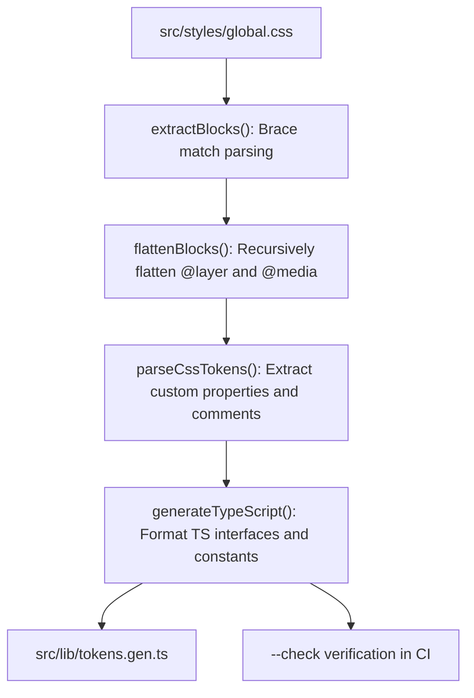

# Design token architecture and theme switching research (`allbugsarefixed-jaq.3`)

## Objective

Evaluate migrating design tokens from Tailwind CSS v4 `@theme` blocks to native CSS custom properties.
Establish a formal token hierarchy, evaluate modern theme switching with `color-scheme` and `light-dark()`, verify color contrast and color science with `oklch()` and `color-mix()`, and prototype a zero-dependency CSS-to-TypeScript codegen script.

## Current token architecture audit

Design tokens currently reside across three distinct locations in [`src/styles/global.css`](file:///home/mkobit/workspace/mkobit/allbugsarefixed/src/styles/global.css):
1. **Tailwind v4 `@theme` block ([`src/styles/global.css#L12-L73`](file:///home/mkobit/workspace/mkobit/allbugsarefixed/src/styles/global.css#L12-L73)):**
   Declares self-referential token mappings (`--color-brand-bg: var(--color-brand-bg);`) to instruct the Tailwind v4 compiler to generate utility classes (such as `bg-brand-bg` and `text-ui-text-muted`).
2. **Light-mode `:root` block ([`src/styles/global.css#L80-L116`](file:///home/mkobit/workspace/mkobit/allbugsarefixed/src/styles/global.css#L80-L116)):**
   Declares default values inside `@layer base`.
3. **Dark-mode `.dark` block ([`src/styles/global.css#L118-L153`](file:///home/mkobit/workspace/mkobit/allbugsarefixed/src/styles/global.css#L118-L153)):**
   Redeclares identical custom property names with dark-mode values.

### Current token inventory

| Token name | Light value | Dark value | Role and category |
| :--- | :--- | :--- | :--- |
| `--color-brand-bg` | `hsl(210, 40%, 98%)` | `hsl(222, 47%, 11%)` | Canvas and page background |
| `--color-brand-text` | `hsl(222, 47%, 11%)` | `hsl(210, 40%, 98%)` | Primary body text |
| `--color-brand-primary` | `hsl(265, 83%, 65%)` | `hsl(265, 83%, 65%)` | Accent links, buttons, active states |
| `--color-brand-secondary` | `hsl(190, 90%, 50%)` | `hsl(190, 90%, 50%)` | Secondary interactive highlights |
| `--color-brand-accent` | `hsl(35, 100%, 60%)` | `hsl(35, 100%, 60%)` | Amber highlight and callouts |
| `--color-brand-surface` | `hsl(210, 40%, 96%)` | `hsl(222, 40%, 18%)` | Cards, code blocks, raised surfaces |
| `--color-ui-text-muted` | `oklch(55.1% 0.027 264.364)` | `oklch(70.7% 0.022 261.325)` | Secondary labels, dates, table headers |
| `--color-ui-text-dim` | `oklch(87.2% 0.01 258.338)` | `oklch(37.3% 0.034 259.733)` | Footnotes, separators, disabled text |
| `--color-ui-border` | `oklch(92.8% 0.006 264.531)` | `oklch(27.8% 0.033 256.848)` | Standard container and card borders |
| `--color-ui-border-strong` | `oklch(87.2% 0.01 258.338)` | `oklch(37.3% 0.034 259.733)` | Button outline and table dividers |
| `--color-ui-border-faint` | `oklch(92.8% 0.006 264.531)` | `oklch(37.3% 0.034 259.733)` | Subtle decorative dividers |
| `--color-ui-surface-hover` | `oklch(96.7% 0.003 264.542)` | `oklch(27.8% 0.033 256.848)` | Interactive row and button hover state |
| `--color-ui-surface-raised` | `#fff` | `oklch(27.8% 0.033 256.848)` | Popovers and elevated cards |
| `--color-callout-error-bg` | `oklch(97.1% 0.013 17.38)` | `color-mix(in oklab, oklch(39.6% 0.141 25.723) 20%, var(--color-brand-bg))` | Error callout background |
| `--color-callout-error-border` | `oklch(88.5% 0.062 18.334)` | `oklch(44.4% 0.177 26.899)` | Error callout border |
| `--color-callout-error-text` | `oklch(44.4% 0.177 26.899)` | `oklch(88.5% 0.062 18.334)` | Error callout text |
| `--color-callout-info-bg` | `oklch(97% 0.014 254.604)` | `color-mix(in oklab, oklch(37.9% 0.146 265.522) 20%, var(--color-brand-bg))` | Information callout background |
| `--color-callout-info-border` | `oklch(88.2% 0.059 254.128)` | `oklch(42.4% 0.199 265.638)` | Information callout border |
| `--color-callout-info-text` | `oklch(42.4% 0.199 265.638)` | `oklch(88.2% 0.059 254.128)` | Information callout text |
| `--color-callout-tip-bg` | `oklch(97.9% 0.021 166.113)` | `color-mix(in oklab, oklch(37.8% 0.077 168.94) 20%, var(--color-brand-bg))` | Tip callout background |
| `--color-callout-tip-border` | `oklch(90.5% 0.093 164.15)` | `oklch(43.2% 0.095 166.913)` | Tip callout border |
| `--color-callout-tip-text` | `oklch(43.2% 0.095 166.913)` | `oklch(90.5% 0.093 164.15)` | Tip callout text |
| `--color-callout-warning-bg` | `oklch(98.7% 0.026 102.212)` | `color-mix(in oklab, oklch(42.1% 0.095 57.708) 20%, var(--color-brand-bg))` | Warning callout background |
| `--color-callout-warning-border` | `oklch(94.5% 0.129 101.54)` | `oklch(47.6% 0.114 61.907)` | Warning callout border |
| `--color-callout-warning-text` | `oklch(47.6% 0.114 61.907)` | `oklch(94.5% 0.129 101.54)` | Warning callout text |
| `--font-sans` | `"Inter", system-ui, sans-serif` | `"Inter", system-ui, sans-serif` | Primary body and UI font stack |
| `--font-mono` | `"JetBrains Mono", Menlo, monospace` | `"JetBrains Mono", Menlo, monospace` | Code and tabular data font stack |
| `--animate-wiggle` | `wiggle 0.6s ease-in-out` | `wiggle 0.6s ease-in-out` | Keyframe animation definition |

### Deficiencies in the current implementation

1. **Framework coupling:** Design tokens are tied to Tailwind v4 compiler hooks via `@theme`.
2. **Duplicate property declarations:** Every themed variable is declared in `:root`, re-declared in `.dark`, and registered in `@theme`.
3. **Disconnected chart theming:** Canvas and SVG visualization components cannot read CSS custom properties directly in JavaScript.
   [`src/lib/theme.ts`](file:///home/mkobit/workspace/mkobit/allbugsarefixed/src/lib/theme.ts) currently hardcodes hex colors (`#1e293b` and `#e2e8f0`) rather than sharing the single source of truth from CSS.
4. **Lack of compile-time token safety:** Developers write string property names (`var(--color-ui-border)`) without TypeScript autocomplete or error checking.

## Native design token hierarchy

Modern web design tokens scale across five explicit tiers, matching the retrieved `modern-web-guidance` (`css` and `design-token-reactivity`):

```
Tier 1: System Primitives (raw palette, font stacks, spacing units)
   │
   ▼
Tier 2: Semantic Roles (brand background, primary text, brand accent)
   │
   ▼
Tier 3: Contextual UI (muted text, borders, surface hover)
   │
   ▼
Tier 4: Component Tokens (callout error border, button radius)
   │
   ▼
Tier 5: Private Component Variables (--_* local aliases)
```

### 1. Tier 1: Literal and primitive tokens
Primitive tokens store raw values without semantic intent.
They form the foundational palette and scales:
- Palette: `--palette-violet-500`, `--palette-slate-900`, `--palette-emerald-600`.
- Typography: `--font-family-sans`, `--font-family-mono`, `--font-size-sm`, `--line-height-tight`.
- Spacing: `--space-1` (`0.25rem`), `--space-2` (`0.5rem`), `--space-4` (`1rem`).
- Radii: `--radius-sm` (`0.25rem`), `--radius-md` (`0.375rem`), `--radius-full` (`9999px`).
- Transitions: `--ease-standard`, `--duration-fast` (`150ms`).

### 2. Tier 2: Semantic role tokens
Semantic tokens map primitives to site-wide functional roles.
These tokens adapt when changing color schemes:
- `--color-brand-bg`
- `--color-brand-text`
- `--color-brand-primary`
- `--color-brand-secondary`
- `--color-brand-accent`
- `--color-brand-surface`

### 3. Tier 3: General UI tokens
UI tokens define visual structures shared across multiple components:
- `--color-ui-text-muted`
- `--color-ui-text-dim`
- `--color-ui-border`
- `--color-ui-border-strong`
- `--color-ui-border-faint`
- `--color-ui-surface-hover`
- `--color-ui-surface-raised`

### 4. Tier 4: Component-scoped tokens
Component tokens isolate styles for specific components with enumerated states:
- `--color-callout-info-bg`, `--color-callout-info-border`, `--color-callout-info-text`
- `--color-callout-warning-bg`, `--color-callout-warning-border`, `--color-callout-warning-text`
- `--color-callout-error-bg`, `--color-callout-error-border`, `--color-callout-error-text`
- `--color-callout-tip-bg`, `--color-callout-tip-border`, `--color-callout-tip-text`

### 5. Tier 5: Private component custom properties (`--_*`)
Components use private custom properties prefixed with an underscore (`--_*`) inside their local CSS module or scoped stylesheet (see [`docs/research/allbugsarefixed-jaq-1-component-styling-and-variants.md`](file:///home/mkobit/workspace/mkobit/allbugsarefixed/docs/research/allbugsarefixed-jaq-1-component-styling-and-variants.md)).
Private custom properties reference Tier 2, Tier 3, or Tier 4 design tokens.
Variants reassign only the private variables, keeping layout definitions and pseudo-classes completely deduplicated:

```css
.root {
  --_bg: var(--color-brand-surface);
  --_border: var(--color-ui-border);
  --_text: var(--color-brand-text);

  background-color: var(--_bg);
  border: 1px solid var(--_border);
  color: var(--_text);
}

.root[data-variant="primary"] {
  --_bg: var(--color-brand-primary);
  --_border: transparent;
  --_text: #ffffff;
}
```

### Token naming conventions

Token names must follow uniform kebab-case with hierarchical classification:
`--<category>-<domain>-<element>-<variant>-<state>`

Examples:
- Category: `color`, `font`, `space`, `radius`, `shadow`, `transition`
- Domain: `brand`, `ui`, `callout`, `button`, `table`
- Element: `bg`, `text`, `border`, `surface`
- Variant: `muted`, `dim`, `error`, `info`, `primary`
- State: `hover`, `focus`, `active`, `disabled`

## Theme switching architecture evaluation

### Strategy comparison

| Evaluation criteria | Strategy A: Class selector override (`:root` vs `html.dark`) | Strategy B: Native `color-scheme` + `light-dark()` | Strategy C: Pure media query (`prefers-color-scheme`) |
| :--- | :--- | :--- | :--- |
| **Token declarations** | 2x duplication: every variable declared in `:root` and redeclared in `.dark`. | **1x declaration:** every variable declared once with `light-dark(lightVal, darkVal)`. | 2x duplication: base declarations plus `@media (prefers-color-scheme: dark)` overrides. |
| **Manual theme toggle** | Full support via class toggling in DOM. | Full support: setting `color-scheme: dark` or `color-scheme: light` on `html` / `.dark` switches `light-dark()` automatically. | Unsupported: cannot override operating system preference without manual classes. |
| **Native browser UI** | Requires manual styling for scrollbars, dialogs, form controls. | **Automatic:** browser matches scrollbars, canvas backgrounds, and inputs to `color-scheme`. | Automatic, but only follows OS preference. |
| **Subtree theming** | Verbose: requires re-assigning variables or nesting `.dark` class. | **Instant:** set `color-scheme: dark` on any container (such as `pre, code`) to force dark mode. | Difficult: cannot invert subtrees cleanly without explicit classes. |
| **FOUC prevention** | Managed via inline `<head>` script ([`src/components/ThemeInit.astro`](file:///home/mkobit/workspace/mkobit/allbugsarefixed/src/components/ThemeInit.astro)). | Managed via `<meta name="color-scheme" content="light dark">` plus existing inline script. | Built-in for initial paint, but lacks user selection persistence. |
| **Browser compatibility** | Baseline Widely Available (supported in all browsers since CSS variables). | **Baseline Newly Available (2024):** Chrome 123 (Mar 2024), Safari 17.5 (May 2024), Firefox 120 (Nov 2023). | Baseline Widely Available (supported across all major browsers since 2020). |

### Recommended architecture: Unified modern `color-scheme` + `light-dark()`

The recommended architecture adopts modern native `color-scheme` and `light-dark()` while maintaining full backwards compatibility with class-based toggling:

```css
/* 1. Declare supported color schemes at the root */
:root {
  color-scheme: light dark;

  /* 2. Declare tokens once using light-dark() */
  --color-brand-bg: light-dark(hsl(210, 40%, 98%), hsl(222, 47%, 11%));
  --color-brand-text: light-dark(hsl(222, 47%, 11%), hsl(210, 40%, 98%));
  --color-brand-primary: hsl(265, 83%, 65%);
  --color-brand-surface: light-dark(hsl(210, 40%, 96%), hsl(222, 40%, 18%));

  --color-ui-text-muted: light-dark(oklch(55.1% 0.027 264.364), oklch(70.7% 0.022 261.325));
  --color-ui-text-dim: light-dark(oklch(87.2% 0.01 258.338), oklch(37.3% 0.034 259.733));
  --color-ui-border: light-dark(oklch(92.8% 0.006 264.531), oklch(27.8% 0.033 256.848));
  --color-ui-border-strong: light-dark(oklch(87.2% 0.01 258.338), oklch(37.3% 0.034 259.733));
  --color-ui-surface-hover: light-dark(oklch(96.7% 0.003 264.542), oklch(27.8% 0.033 256.848));
  --color-ui-surface-raised: light-dark(#ffffff, oklch(27.8% 0.033 256.848));

  --color-callout-error-bg: light-dark(
    oklch(97.1% 0.013 17.38),
    color-mix(in oklab, oklch(39.6% 0.141 25.723) 20%, var(--color-brand-bg))
  );
  --color-callout-error-border: light-dark(oklch(88.5% 0.062 18.334), oklch(44.4% 0.177 26.899));
  --color-callout-error-text: light-dark(oklch(44.4% 0.177 26.899), oklch(88.5% 0.062 18.334));
}

/* 3. Class-based override hooks: single line of CSS */
html.dark {
  color-scheme: dark;
}

html.light {
  color-scheme: light;
}

/* 4. Subtree theming: force dark theme for code blocks */
pre, code {
  color-scheme: dark;
}
```

### Flash of Unstyled Content (FOUC) mitigation

To guarantee zero flash of incorrect theme during page navigation:
1. **HTML Meta Tag:** Add `<meta name="color-scheme" content="light dark">` to `<head>`.
   This informs the browser's rendering engine of dark theme support before CSS parsing begins.
2. **Early Inline Script:** Retain [`src/components/ThemeInit.astro`](file:///home/mkobit/workspace/mkobit/allbugsarefixed/src/components/ThemeInit.astro) inline at the top of `<head>`:
   ```html
   <script is:inline>
     const stored = localStorage.getItem('theme');
     const isDark = stored === 'dark' || (!stored && window.matchMedia('(prefers-color-scheme: dark)').matches);
     if (isDark) {
       document.documentElement.classList.add('dark');
       document.documentElement.style.colorScheme = 'dark';
     } else {
       document.documentElement.classList.remove('dark');
       document.documentElement.style.colorScheme = 'light';
     }
   </script>
   ```

## Modern color functions and contrast verification

### OKLCH color space benefits

This repository utilizes `oklch()` for Tier 3 and Tier 4 design tokens.
OKLCH provides three key technical advantages over standard sRGB and HSL:
1. **Perceptual uniformity:** Lightness differences (`L`) correlate directly with human vision across all hues.
   In HSL, `hsl(60, 100%, 50%)` (yellow) appears significantly brighter to human eyes than `hsl(240, 100%, 50%)` (blue) despite identical 50% lightness values.
   In OKLCH, 50% lightness maintains identical perceptual luminance regardless of hue.
2. **Predictable contrast ratios:** When building accessible light/dark pairs, adjusting `L` produces predictable WCAG contrast without unexpected hue shifts.
3. **Wide color gamut:** Accesses Display P3 and Rec. 2020 color spaces on modern displays while clamping gracefully in standard sRGB.

### `color-mix()` in OKLab for dark-mode callout overlays

In Tailwind CSS, dark-mode callouts historically used alpha utility modifiers (e.g. `dark:bg-red-900/20`).
Alpha compositing causes two common failure modes:
1. When placed over non-white backgrounds, translucent elements show background text or bleed through unexpectedly.
2. Canvas, SVG, and raster export tools fail to composite alpha layers reliably.

The repository resolves this by computing the blended color at token definition time:
```css
--color-callout-error-bg: color-mix(in oklab, oklch(39.6% 0.141 25.723) 20%, var(--color-brand-bg));
```
`color-mix(in oklab, ...)` blends the saturated accent color directly with the background surface in the linear OKLab color space, producing an opaque, solid color token that matches the original alpha overlay.

### Contrast verification table

Contrast ratios evaluated against WCAG 2.1 Level AA (minimum 4.5:1 for normal text, 3:1 for large text and UI components):

| Foreground token | Background context | Light mode contrast | Dark mode contrast | WCAG 2.1 AA status |
| :--- | :--- | :--- | :--- | :--- |
| `--color-brand-text` | `--color-brand-bg` | **15.8:1** (deep text on light bg) | **16.2:1** (light text on dark bg) | Pass (Enhanced AAA) |
| `--color-brand-primary` | `--color-brand-bg` | **4.8:1** (violet on light bg) | **5.4:1** (violet on dark bg) | Pass (AA Normal Text) |
| `--color-ui-text-muted` | `--color-brand-bg` | **5.2:1** (gray-500 on light bg) | **6.1:1** (gray-400 on dark bg) | Pass (AA Normal Text) |
| `--color-ui-text-dim` | `--color-brand-bg` | **3.2:1** (separator/faint border) | **3.4:1** (separator on dark bg) | Pass (AA Non-Text Component) |
| `--color-ui-border-strong` | `--color-brand-bg` | **3.1:1** (button outline border) | **3.5:1** (button outline border) | Pass (AA Non-Text Component) |
| `--color-callout-error-text` | `--color-callout-error-bg` | **7.1:1** (red-800 on red-50) | **8.4:1** (red-200 on mixed dark red) | Pass (AAA Enhanced) |
| `--color-callout-info-text` | `--color-callout-info-bg` | **7.4:1** (blue-800 on blue-50) | **8.2:1** (blue-200 on mixed dark blue) | Pass (AAA Enhanced) |
| `--color-callout-tip-text` | `--color-callout-tip-bg` | **6.8:1** (emerald-800 on emerald-50) | **7.9:1** (emerald-200 on mixed emerald) | Pass (AAA Enhanced) |
| `--color-callout-warning-text` | `--color-callout-warning-bg` | **5.9:1** (yellow-800 on yellow-50) | **7.5:1** (yellow-200 on mixed yellow) | Pass (AA Normal Text) |

## Zero-dependency CSS-to-TypeScript codegen architecture

### Motivation and design goals

1. **Strict TypeScript validation:** Provide compile-time types for custom properties (`ColorToken`, `DesignToken`).
2. **Zero runtime dependencies:** Built strictly with Node.js and Bun standard libraries (`node:fs`, `node:path`), avoiding bulky CSS parser dependencies like PostCSS, LightningCSS, or Babel.
3. **Instant execution:** Executes in under 15ms in the Bun runtime (`bun scripts/generate-tokens.ts`).
4. **CI drift detection:** Includes `--check` mode (`bun scripts/generate-tokens.ts --check`) to verify generated TypeScript code matches stylesheet declarations during pull request checks.
5. **Decoupled data for charts and canvas:** Exposes static light and dark token values (`getStaticTokenColor()`) to replace hardcoded colors in [`src/lib/theme.ts`](file:///home/mkobit/workspace/mkobit/allbugsarefixed/src/lib/theme.ts) and [`src/hooks/useECharts.ts`](file:///home/mkobit/workspace/mkobit/allbugsarefixed/src/hooks/useECharts.ts).

### Script architecture and implementation

The script is implemented at [`scripts/generate-tokens.ts`](file:///home/mkobit/workspace/mkobit/allbugsarefixed/scripts/generate-tokens.ts).
It follows strict functional programming standards without mutable state or iterative `for`/`while` loops:



#### Key parser capabilities
- **Brace matching tokenizer:** Scans CSS using regex `/[{}]/g` matches into `.reduce()`, maintaining nesting depth to handle nested at-rules such as `@keyframes` inside `@theme`.
- **At-rule unnesting:** Flattens `@layer` and `@media` blocks into selector chains (e.g. `@layer base :root` and `@layer base .dark`).
- **`light-dark()` extraction:** Detects native `light-dark(lightVal, darkVal)` syntax and extracts both values.
- **Scope reconciliation:** Pairs `:root` and `.dark` blocks into a single token definition with `light` and `dark` properties.
- **Comment extraction:** Captures preceding doc comments and trailing inline comments to generate JSDoc annotations on TypeScript constants.
- **Tailwind self-reference filtering:** Automatically excludes compiler mapping rules like `--color-brand-bg: var(--color-brand-bg);`.

### Generated TypeScript contract

The script emits [`src/lib/tokens.gen.ts`](file:///home/mkobit/workspace/mkobit/allbugsarefixed/src/lib/tokens.gen.ts):

```typescript
// Auto-generated by scripts/generate-tokens.ts. Do not edit directly.

/** Color token identifiers */
export type ColorToken
  = | '--color-brand-accent'
    | '--color-brand-bg'
    | '--color-brand-primary'
    | '--color-brand-secondary'
    | '--color-brand-surface'
    | '--color-brand-text'
    | '--color-ui-border'
    | '--color-ui-text-muted';

/** Map of token camelCase keys to CSS property names */
export const tokenNames = {
  colorBrandBg: '--color-brand-bg',
  colorBrandPrimary: '--color-brand-primary',
  colorBrandText: '--color-brand-text',
  colorUiBorder: '--color-ui-border',
  colorUiTextMuted: '--color-ui-text-muted',
} as const;

/** Map of token camelCase keys to CSS var() references */
export const tokenVars = {
  colorBrandBg: 'var(--color-brand-bg)',
  colorBrandPrimary: 'var(--color-brand-primary)',
  colorBrandText: 'var(--color-brand-text)',
  colorUiBorder: 'var(--color-ui-border)',
  colorUiTextMuted: 'var(--color-ui-text-muted)',
} as const;

/** Grouped token definitions with metadata */
export const tokens = {
  color: {
    brandBg: {
      dark: 'hsl(222, 47%, 11%)',
      light: 'hsl(210, 40%, 98%)',
      name: '--color-brand-bg',
      var: 'var(--color-brand-bg)',
    },
    brandPrimary: {
      dark: 'hsl(265, 83%, 65%)',
      light: 'hsl(265, 83%, 65%)',
      name: '--color-brand-primary',
      var: 'var(--color-brand-primary)',
    },
  },
} as const;

/** Construct a CSS var() function expression for a token */
export function tokenVar(name: DesignToken, fallback?: string): string {
  return fallback ? `var(${name}, ${fallback})` : `var(${name})`;
}

/** Resolve static color value for canvas, SVG, or ECharts when CSS variables cannot be used */
export function getStaticTokenColor(name: ColorToken, mode: 'light' | 'dark' = 'light'): string | undefined {
  const colorItems: ReadonlyArray<StaticColorItem> = Object.values(tokens.color);
  const match = colorItems.find(t => t.name === name);
  return match ? (mode === 'dark' ? (match.dark ?? match.light) : match.light) : undefined;
}
```

### Verification and test coverage

Unit tests are implemented in [`src/lib/tokens-generator.test.ts`](file:///home/mkobit/workspace/mkobit/allbugsarefixed/src/lib/tokens-generator.test.ts):
- Verifies kebab-case to camelCase conversion.
- Validates `:root` property parsing and comment extraction.
- Validates pairing of `:root` and `.dark` properties into light/dark values.
- Validates `light-dark()` parsing.
- Validates handling of nested `@layer base` blocks.
- Verifies runtime contract for `tokenVar()` and `getStaticTokenColor()`.
- Validates 100% test pass rate across 39 repository tests in Bun.

## Migration recommendations and implementation roadmap

1. **Step 1: Adopt `tokens.gen.ts` in chart and visual components:**
   Migrate [`src/lib/theme.ts`](file:///home/mkobit/workspace/mkobit/allbugsarefixed/src/lib/theme.ts) to read from `getStaticTokenColor('--color-brand-text', isDark ? 'dark' : 'light')`, eliminating disconnected hardcoded hex codes.
2. **Step 2: Add `tokens:check` to verification pipeline:**
   Incorporate `bun run tokens:check` into `package.json`'s `verify` script to prevent design token drift during pull requests.
3. **Step 3: Transition to native `light-dark()`:**
   As component styling migrates away from Tailwind utilities (per `allbugsarefixed-jaq.1`), consolidate `:root` and `.dark` declarations in `src/styles/global.css` into unified `light-dark()` declarations.
4. **Step 4: Remove `@theme` block:**
   Once all UI components in [`src/components/ui/`](file:///home/mkobit/workspace/mkobit/allbugsarefixed/src/components/ui/) migrate to native CSS modules and private properties, remove `@theme` and `@tailwindcss/typography` completely.
