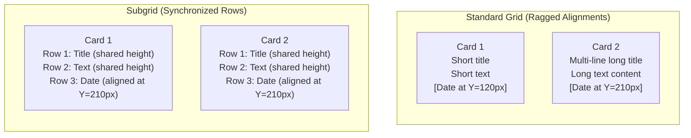
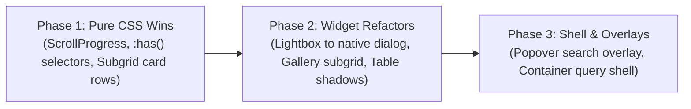

# Modern CSS features for layouts and widgets research (`allbugsarefixed-jaq.4`)

## Objective

Evaluate modern CSS layout and widget features to replace Tailwind CSS utility classes and JavaScript layout workarounds.
Audit widgets and layout components across [`src/`](file:///home/mkobit/workspace/mkobit/allbugsarefixed/src/).
Evaluate container queries (`@container`), CSS subgrid, the native `:has()` selector, scroll-driven animations, the Popover API, and CSS anchor positioning.
Define technical recommendations, concrete implementation prototypes, and migration strategies.

## Codebase layout and widget audit

The repository contains interactive widgets, content presentation blocks, and structural layout containers.
Components currently rely on Tailwind CSS utility classes, media queries (`@media`), and JavaScript listeners to manage responsive states and layouts.

### Audited components inventory

| Component | File location | Current layout mechanism | Current styling runtime | Identified layout limitations |
| :--- | :--- | :--- | :--- | :--- |
| `Gallery` | [`src/components/Gallery.tsx`](file:///home/mkobit/workspace/mkobit/allbugsarefixed/src/components/Gallery.tsx#L9-L15) | CSS grid with viewport breakpoint (`sm:grid-cols-3`) | `tailwind-variants` | Viewport queries cause layout breaks if the container width changes; child images do not align with captions across rows. |
| `Lightbox` | [`src/components/Lightbox.tsx`](file:///home/mkobit/workspace/mkobit/allbugsarefixed/src/components/Lightbox.tsx#L19-L40) | Fixed flex overlay via `@headlessui/react` | `tailwind-variants` + Headless UI | Requires a large third-party JavaScript bundle; transitions depend on custom data attributes (`data-closed`, `data-enter`). |
| `PostImageLightbox` | [`src/components/PostImageLightbox.tsx`](file:///home/mkobit/workspace/mkobit/allbugsarefixed/src/components/PostImageLightbox.tsx#L18-L51) | Client-side DOM manipulation on `.prose img` | Raw utility strings | Replaces DOM image tags imperatively in React `useEffect`; couples to `Lightbox`. |
| `DataTable` | [`src/components/ui/table.tsx`](file:///home/mkobit/workspace/mkobit/allbugsarefixed/src/components/ui/table.tsx#L20-L30) | HTML `<table>` in an overflow container | `tailwind-variants` multi-slot | No visual scroll shadows to indicate horizontal overflow; checkbox row selection requires manual Tailwind selectors. |
| `Callout` | [`src/components/ui/callout.tsx`](file:///home/mkobit/workspace/mkobit/allbugsarefixed/src/components/ui/callout.tsx#L5-L18) | Flexbox with fixed spacing | `tailwind-variants` | Cannot adapt layout based on container width; cannot adjust icon vertical alignment based on whether a header exists. |
| `BlogCard` | [`src/components/BlogCard.tsx`](file:///home/mkobit/workspace/mkobit/allbugsarefixed/src/components/BlogCard.tsx#L8-L10) | Block layout with flex metadata | `tailwind-variants` | Titles, descriptions, and tag clusters have different heights across grid cells, which misaligns card footers across columns. |
| `ScrollProgress` | [`src/components/ui/ScrollProgress.tsx`](file:///home/mkobit/workspace/mkobit/allbugsarefixed/src/components/ui/ScrollProgress.tsx#L13-L39) | Fixed button with SVG circle | React `useEffect` + scroll listeners | Uses continuous JavaScript scroll listeners on the main thread; re-renders React state on every scroll frame. |
| `Search` | [`src/components/Search.tsx`](file:///home/mkobit/workspace/mkobit/allbugsarefixed/src/components/Search.tsx#L8-L16) | Absolute dropdown (`top-full`) | `tailwind-variants` | Overflows parent containers or clipping boundaries; relies on a `setTimeout` 200 ms blur hack for light dismiss. |
| `TableOfContents` | [`src/components/TableOfContents.tsx`](file:///home/mkobit/workspace/mkobit/allbugsarefixed/src/components/TableOfContents.tsx#L12-L35) | Sticky sidebar list | `IntersectionObserver` in React | Requires client-side JavaScript execution to detect the active heading. |
| `CodeBlock` | [`src/components/CodeBlock.tsx`](file:///home/mkobit/workspace/mkobit/allbugsarefixed/src/components/CodeBlock.tsx#L49-L86) | Block preformatted container | Tailwind utility classes | Lacks scroll overflow indicators for wide code lines. |
| `Header` | [`src/components/Header.tsx`](file:///home/mkobit/workspace/mkobit/allbugsarefixed/src/components/Header.tsx#L13-L31) | Fixed bar with sliding mobile menu | `tailwind-variants` + React state | Mobile menu state requires React state (`isMenuOpen`) and explicit window resize listeners. |
| `Footer` | [`src/components/Footer.tsx`](file:///home/mkobit/workspace/mkobit/allbugsarefixed/src/components/Footer.tsx#L6-L17) | Viewport-based grid (`md:grid-cols-2`) | `tailwind-variants` | Uses screen-width queries rather than container width to collapse columns. |
| `Layout` | [`src/layouts/Layout.astro`](file:///home/mkobit/workspace/mkobit/allbugsarefixed/src/layouts/Layout.astro#L54-L68) | Flex column shell with hardcoded `pt-14` | Tailwind utility classes | Fixed top offset is hardcoded to header height; no container query boundary is set for child widgets. |
| `Container` | [`src/components/ui/container.tsx`](file:///home/mkobit/workspace/mkobit/allbugsarefixed/src/components/ui/container.tsx#L5-L18) | Fixed `max-w-*` wrappers | `tailwind-variants` | Uses arbitrary screen max-widths rather than container contexts. |
| `Heading` | [`src/components/ui/heading.tsx`](file:///home/mkobit/workspace/mkobit/allbugsarefixed/src/components/ui/heading.tsx#L5-L20) | Flex text with anchor link | `tailwind-variants` + `.group` | Depends on the Tailwind `.group` class and `group-hover:opacity-100` hack to reveal anchor links. |

### Technical deficiencies of current implementations

1. **Tight coupling to viewport dimensions:**
   Components like `Gallery`, `BlogCard`, and `Footer` use viewport media queries (`sm:`, `md:`, `lg:`).
   When a component is moved into a sidebar, a modal, or a multi-column page layout, viewport media queries fail because the component width does not match the screen width.

2. **Ragged alignment in multi-column collections:**
   Components in collection lists have variable content lengths.
   In `BlogCard`, varying title lengths and badge counts push the date metadata down to different vertical positions across adjacent cards.
   CSS grid cannot align nested child elements across rows without CSS subgrid.

3. **Heavy JavaScript overhead for native browser features:**
   `Lightbox` imports `@headlessui/react` to manage top-layer focus trapping, backdrops, and modal state.
   `ScrollProgress` runs JavaScript on every scroll event to calculate page progress and toggle button visibility.
   Modern CSS and HTML standards support these capabilities natively with zero JavaScript bundle overhead.

4. **Fragile positioning and dismissal mechanics:**
   `Search` uses `position: absolute` with `top-full`.
   This causes layout clipping inside containers that have `overflow: hidden`.
   The component also uses a `setTimeout` timer during `onBlur` to prevent premature closure when users click search results.

## Container queries evaluation

Container queries enable components to style their contents based on the dimensions of their parent container rather than the browser viewport.

### Container query types and units

1. **Size container queries (`container-type: inline-size`):**
   Monitors the inline axis (width) of the container.
   Child selectors query this container with `@container (min-width: <length>)` or `@container (max-width: <length>)`.
   `inline-size` avoids circular layout dependencies on the block (vertical) axis.

2. **Container query units:**
   - `cqw`: 1% of the container width.
   - `cqh`: 1% of the container height.
   - `cqi`: 1% of the container inline size.
   - `cqb`: 1% of the container block size.
   These units permit fluid typography, proportional padding, and responsive gaps that adapt smoothly to available container space.

3. **Scroll-state container queries (`container-type: scroll-state`):**
   An emerging standard that allows styling children based on container scroll states (`@container scroll-state(scrollable: top)` or `scrollable: inline-end`).
   This enables scroll indicator shadows without JavaScript listeners.

### Component applicability matrix

| Target component | Query target | Applied modern CSS technique | Architectural benefit |
| :--- | :--- | :--- | :--- |
| `BlogCard` | `.blog-card-container` | `container-type: inline-size; @container (min-width: 500px)` | Cards switch between stacked mobile layouts and horizontal split layouts based on available column width. |
| `Gallery` | `.gallery-container` | `container-type: inline-size; @container (min-width: 480px)` | Grid columns adapt dynamically (1, 2, or 3 columns) whether placed in full prose, an aside, or a split pane. |
| `Callout` | `.callout` | `container-type: inline-size; @container (max-width: 360px)` | Compact containers stack the icon and title vertically to avoid narrow text columns. |
| `DataTable` | `.table-wrapper` | `container-type: inline-size; @container (max-width: 540px)` | Narrow containers can transform complex wide table rows into stacked card presentations. |
| `Footer` | `.site-footer` | `container-type: inline-size; @container (min-width: 640px)` | Footer navigation links switch between 1, 2, and 4 columns based on footer container width. |

### Technical constraints and gotchas

- Setting `container-type: inline-size` establishes a new containment context for all descendants.
- An element cannot query its own container context directly; it can only query an ancestor container.
- Always provide a standard CSS fallback layout (such as a single-column stacked layout) outside `@container` blocks for browsers without support.

## CSS subgrid evaluation

CSS subgrid lets a grid item inherit the track definitions of its parent grid along one or both axes.

### Solving the ragged alignment problem

In standard CSS grid, child items establish an independent formatting context.
When card items contain multiple elements (such as an image, title, excerpt, and footer), differences in title or excerpt length cause uneven vertical positions across sibling cards.



### Component applicability

1. **`BlogCard` listings ([`src/pages/blog/index.astro`](file:///home/mkobit/workspace/mkobit/allbugsarefixed/src/pages/blog/index.astro#L21-L34)):**
   Define a parent grid with explicit row tracks (`grid-template-rows: auto 1fr auto auto`).
   Set cards to span rows (`grid-row: span 4`) with `grid-template-rows: subgrid`.
   Titles, descriptions, label badges, and publication dates align across all cards in each row.

2. **`Gallery` ([`src/components/Gallery.tsx`](file:///home/mkobit/workspace/mkobit/allbugsarefixed/src/components/Gallery.tsx#L9-L15)):**
   For galleries with image captions and action buttons, subgrid aligns image frames and caption text boxes across columns automatically.

3. **`DataTable` ([`src/components/ui/table.tsx`](file:///home/mkobit/workspace/mkobit/allbugsarefixed/src/components/ui/table.tsx#L55-L96)):**
   For custom data lists rendered with semantic `<div>` or `<ul>` structures, subgrid provides tabular column alignment across rows while preserving responsive flexibility.

### Technical rules for subgrid

- Define explicit tracks on the parent grid before declaring subgrid on the child item.
- Only subgrid the axis that requires alignment; use `grid-auto-rows` or `grid-auto-columns` on the independent axis.
- Provide a standard grid or flexbox fallback before the subgrid declaration in the cascade.

## Native `:has()` relational selector evaluation

The native `:has()` pseudo-class enables parent and sibling elements to change styling based on the state or presence of descendant elements.

### Key use cases in the codebase

1. **Table row selection and header states ([`src/components/ui/table.tsx`](file:///home/mkobit/workspace/mkobit/allbugsarefixed/src/components/ui/table.tsx#L27)):**
   - Replace `data-[state=selected]` class injection with `tr:has(input[type="checkbox"]:checked)`.
   - Style sorted column headers: `th:has(button[aria-sort="ascending"])` or `th:has([data-sorted="true"])`.
   - Remove padding on cells with checkboxes: `td:has(input[type="checkbox"]) { padding-inline-end: 0; }`.

2. **Heading link reveal ([`src/components/ui/heading.tsx`](file:///home/mkobit/workspace/mkobit/allbugsarefixed/src/components/ui/heading.tsx#L29-L39)):**
   - Currently uses Tailwind `.group` and `group-hover:opacity-100`.
   - Replace with native selector:
     ```css
     .ui-heading a {
       opacity: 0;
       transition: opacity 0.2s ease;
     }
     .ui-heading:is(:hover, :focus-within) a {
       opacity: 1;
     }
     ```
   - Eliminates the need for synthetic `.group` utility classes on the heading wrapper.

3. **Callout header detection ([`src/components/ui/callout.tsx`](file:///home/mkobit/workspace/mkobit/allbugsarefixed/src/components/ui/callout.tsx#L37-L44)):**
   - When a callout contains a title (`h3`), align the icon with the first text line.
   - When a callout has no title, center the icon with single-line paragraph content:
     ```css
     .ui-callout {
       align-items: center;
     }
     .ui-callout:has(h3) {
       align-items: flex-start;
     }
     ```

4. **App shell state coordination ([`src/components/Header.tsx`](file:///home/mkobit/workspace/mkobit/allbugsarefixed/src/components/Header.tsx#L13-L31)):**
   - Detect open mobile menus or open dialogs to lock page scroll without JavaScript state sync:
     ```css
     body:has(#mobile-menu:popover-open),
     body:has(dialog[open]) {
       overflow: hidden;
     }
     ```

### Performance guidelines for `:has()`

- Scope `:has()` selectors to specific component containers (e.g., `.ui-table tr:has(...)`).
- Do not use unbounded universal selectors like `body:has(*)`.
- Anchor `:has()` to direct child selectors when possible (`.container:has(> .active)`).

## Scroll and animation capabilities evaluation

### Scroll-driven animations (`animation-timeline: scroll() / view()`)

Scroll-driven animations let the browser compositor drive CSS animations directly from scroll position changes.
This bypasses main-thread JavaScript execution.

#### Audit of `ScrollProgress` component

[`ScrollProgress.tsx`](file:///home/mkobit/workspace/mkobit/allbugsarefixed/src/components/ui/ScrollProgress.tsx#L1-L99) currently registers window scroll and resize listeners, computes mathematical ratios, and updates React component state continuously.

Replacing this with native CSS scroll-driven animations delivers significant improvements:
- Eliminates 50 lines of React effect and state handling.
- Eliminates main-thread scroll event listeners.
- Runs animations entirely on the GPU compositor thread for 60/120 FPS smoothness.
- Allows rendering `ScrollProgress` as a static Astro component with zero client JavaScript bundle overhead.

#### Prototype: Native scroll progress indicator

```css
@keyframes grow-scroll-progress {
  from {
    transform: scaleX(0);
  }
  to {
    transform: scaleX(1);
  }
}

.scroll-progress-bar {
  position: fixed;
  inset-block-start: 0;
  inset-inline-start: 0;
  inline-size: 100%;
  block-size: 3px;
  background-color: var(--color-brand-primary);
  transform-origin: 0% 50%;
  z-index: 100;
  pointer-events: none;
}

@supports (animation-timeline: scroll()) {
  @media (prefers-reduced-motion: no-preference) {
    .scroll-progress-bar {
      animation: grow-scroll-progress auto linear;
      animation-timeline: scroll(root block);
    }
  }
}
```

For the circular progress button, SVG stroke offsets can be animated with `@keyframes`:

```css
@keyframes update-stroke-offset {
  from {
    stroke-dashoffset: 125.66; /* 2 * PI * 20 */
  }
  to {
    stroke-dashoffset: 0;
  }
}

.scroll-top-progress-ring {
  stroke-dasharray: 125.66;
  animation: update-stroke-offset auto linear;
  animation-timeline: scroll(root block);
}
```

### Native top layer, Popover API, and `<dialog>`

The HTML `<dialog>` element and the Popover API (`popover="auto" | "manual"`) place overlay elements directly into the browser top layer.

#### Lightbox migration analysis

[`Lightbox.tsx`](file:///home/mkobit/workspace/mkobit/allbugsarefixed/src/components/Lightbox.tsx#L75-L107) currently uses `@headlessui/react` `Dialog`.
Migrating to native `<dialog>` provides:
- Native modal focus trapping and keyboard navigation without third-party libraries.
- Built-in `Escape` key handling.
- Native `::backdrop` pseudo-element with hardware-accelerated dimming.
- Complete removal of `@headlessui/react` from the client bundle.

#### Smooth entry and exit animations for `<dialog>` and Popovers

Historically, animating elements from `display: none` required complex JavaScript timers.
Modern CSS provides `@starting-style`, `transition-behavior: allow-discrete`, and the `overlay` property (see `modern-web-guidance` guide `animate-to-from-top-layer`).

```css
dialog.ui-lightbox {
  opacity: 0;
  transform: scale(0.95);
  transition-property: opacity, transform, display, overlay;
  transition-duration: 0.25s;
  transition-timing-function: cubic-bezier(0.16, 1, 0.3, 1);
  transition-behavior: allow-discrete;
}

dialog.ui-lightbox[open] {
  opacity: 1;
  transform: scale(1);

  @starting-style {
    opacity: 0;
    transform: scale(0.95);
  }
}

dialog.ui-lightbox::backdrop {
  background-color: rgba(0, 0, 0, 0);
  transition-property: background-color, display, overlay;
  transition-duration: 0.25s;
  transition-timing-function: ease-out;
  transition-behavior: allow-discrete;
}

dialog.ui-lightbox[open]::backdrop {
  background-color: rgba(0, 0, 0, 0.8);

  @starting-style {
    background-color: rgba(0, 0, 0, 0);
  }
}
```

### CSS anchor positioning and Search overlay

[`Search.tsx`](file:///home/mkobit/workspace/mkobit/allbugsarefixed/src/components/Search.tsx#L8-L16) currently tethers its dropdown using `position: absolute` with `top-full`.
This layout breaks if the container uses `overflow: hidden`, and requires a 200 ms timeout on blur to allow result clicks.

CSS anchor positioning and the Popover API resolve these issues:
1. The search input is declared as an anchor: `anchor-name: --search-input`.
2. The search dropdown is declared with `popover="auto"` and `position-anchor: --search-input`.
3. The dropdown is positioned with `position-area: block-end span-inline-end`.
4. The browser automatically flips the dropdown above the input if it reaches the bottom of the screen (`position-try-fallbacks: flip-block`).
5. Native light dismiss handles closing the dropdown when users click outside, eliminating JavaScript timeout hacks.

## Component migration specifications and prototypes

### 1. `Gallery` and `Lightbox` component specification

#### Gallery CSS Module (`src/components/Gallery.module.css`)

```css
.galleryGrid {
  display: grid;
  grid-template-columns: repeat(2, minmax(0, 1fr));
  gap: var(--space-4, 1rem);
  margin-block: var(--space-6, 1.5rem);
  container-type: inline-size;
}

@container (min-width: 480px) {
  .galleryGrid {
    grid-template-columns: repeat(3, minmax(0, 1fr));
  }
}

.galleryTrigger {
  display: block;
  inline-size: 100%;
  block-size: 100%;
  cursor: zoom-in;
  overflow: hidden;
  border-radius: var(--radius-xl, 0.75rem);
  border: 0;
  background: transparent;
  padding: 0;
  text-align: start;
}

.galleryTrigger:focus-visible {
  outline: 2px solid var(--color-brand-primary);
  outline-offset: 2px;
}
```

#### Lightbox component with native `<dialog>`

```tsx
import React, { useEffect, useRef } from 'react'
import { ChevronLeft, ChevronRight, X } from 'lucide-react'
import styles from './Lightbox.module.css'

export interface LightboxImage {
  readonly src: string
  readonly alt: string
}

export interface LightboxProps {
  readonly images: readonly LightboxImage[]
  readonly initialIndex: number
  readonly open: boolean
  readonly onClose: () => void
}

export function Lightbox({ images, initialIndex, open, onClose }: Readonly<LightboxProps>) {
  const dialogRef = useRef<HTMLDialogElement>(null)
  const [currentIndex, setCurrentIndex] = React.useState(initialIndex)

  useEffect(() => {
    const dialog = dialogRef.current
    if (!dialog) return

    if (open && !dialog.open) {
      setCurrentIndex(initialIndex)
      dialog.showModal()
    } else if (!open && dialog.open) {
      dialog.close()
    }
  }, [open, initialIndex])

  const currentImage = images[currentIndex]
  if (!currentImage) return null

  return (
    <dialog
      ref={dialogRef}
      className={styles.dialog}
      onClose={onClose}
      aria-label="Image lightbox"
    >
      <div className={styles.contentWrapper}>
        
        <button
          type="button"
          onClick={onClose}
          className={styles.closeButton}
          aria-label="Close"
        >
          <X size={20} aria-hidden="true" />
        </button>
      </div>
    </dialog>
  )
}
```

### 2. `BlogCard` and blog index grid specification

#### Blog index page layout (`src/pages/blog/index.astro`)

```astro
---
import Layout from '../../layouts/Layout.astro'
import { BlogCard } from '../../components/BlogCard'
// Fetch posts collection...
---

<Layout title="All posts">
  <h1 class="page-title">All posts</h1>
  <div class="blog-grid">
    {posts.map(post => (
      <BlogCard
        title={post.data.title}
        description={post.data.description}
        pubDate={post.data.pubDate}
        href={`/blog/${post.id}/`}
        labels={post.data.labels}
      />
    ))}
  </div>
</Layout>

<style>
  .blog-grid {
    display: grid;
    grid-template-columns: repeat(auto-fit, minmax(min(100%, 320px), 1fr));
    gap: 1.5rem;
    grid-auto-rows: auto;
  }
</style>
```

#### Blog card styles (`src/components/BlogCard.module.css`)

```css
.cardContainer {
  container-type: inline-size;
  height: 100%;
}

.card {
  display: grid;
  /* 4 rows: Title, Excerpt, Labels, Date Footer */
  grid-template-rows: subgrid;
  grid-row: span 4;
  gap: 0.75rem;
  padding: 1.5rem;
  border: 1px solid var(--color-ui-border);
  border-radius: var(--radius-lg, 0.5rem);
  background-color: var(--color-brand-surface);
  text-decoration: none;
  transition: border-color 0.2s ease, transform 0.2s ease;
}

.card:is(:hover, :focus-visible) {
  border-color: var(--color-brand-primary);
  transform: translateY(-2px);
}

.title {
  margin: 0;
  font-size: 1.25rem;
  font-weight: 700;
  color: var(--color-brand-text);
  line-height: 1.3;
}

.description {
  margin: 0;
  color: var(--color-ui-text-muted);
  font-size: 0.875rem;
  line-height: 1.5;
}

.badgeList {
  display: flex;
  flex-wrap: wrap;
  gap: 0.5rem;
  align-self: start;
}

.footer {
  margin-block-start: auto;
  font-size: 0.75rem;
  color: var(--color-ui-text-dim);
}

/* Horizontal card presentation in wide containers */
@container (min-width: 540px) {
  .cardWide {
    grid-template-columns: 1fr auto;
    align-items: center;
  }
}
```

### 3. `DataTable` specification (`src/components/ui/table.module.css`)

```css
.wrapper {
  border: 1px solid var(--color-ui-border);
  border-radius: var(--radius-md, 0.375rem);
  overflow: hidden;
  container-type: inline-size;
}

.scroller {
  inline-size: 100%;
  overflow-x: auto;
  position: relative;
  scrollbar-width: thin;
  scrollbar-color: var(--color-ui-border-strong) transparent;
}

.table {
  inline-size: 100%;
  border-collapse: collapse;
  text-align: start;
  font-size: 0.875rem;
}

.headCell {
  padding: 0.75rem 1rem;
  font-weight: 600;
  color: var(--color-ui-text-muted);
  border-bottom: 1px solid var(--color-ui-border);
}

.cell {
  padding: 0.75rem 1rem;
  color: var(--color-brand-text);
  border-bottom: 1px solid var(--color-ui-border-faint);
}

/* Clean :has() selection without utility overrides */
.headCell:has([type="checkbox"]),
.cell:has([type="checkbox"]) {
  padding-inline-end: 0;
  inline-size: 2.5rem;
}

.row:hover {
  background-color: var(--color-ui-surface-hover);
}

.row:has(input[type="checkbox"]:checked) {
  background-color: var(--color-ui-surface-hover);
}

/* Scroll indicator shadow affordances using scroll-driven animations */
@supports (animation-timeline: scroll()) {
  .scroller {
    background:
      /* Shadow covers */
      linear-gradient(to right, var(--color-brand-bg) 30%, rgba(255, 255, 255, 0)),
      linear-gradient(to left, var(--color-brand-bg) 30%, rgba(255, 255, 255, 0)) 100% 0,
      /* Shadows */
      radial-gradient(farthest-side at 0 50%, rgba(0, 0, 0, 0.15), rgba(0, 0, 0, 0)),
      radial-gradient(farthest-side at 100% 50%, rgba(0, 0, 0, 0.15), rgba(0, 0, 0, 0)) 100% 0;
    background-repeat: no-repeat;
    background-size: 40px 100%, 40px 100%, 14px 100%, 14px 100%;
    background-attachment: local, local, scroll, scroll;
  }
}
```

### 4. `ScrollProgress` specification (`src/components/ui/ScrollProgress.astro`)

```astro
---
import { ArrowUp } from 'lucide-react'
---

<div id="scroll-progress-container" class="scroll-widget" aria-hidden="true">
  <div class="scroll-bar"></div>
  <button
    id="back-to-top"
    type="button"
    class="back-to-top-button"
    aria-label="Scroll to top"
  >
    <ArrowUp className="icon" />
  </button>
</div>

<script>
  const button = document.getElementById('back-to-top')
  button?.addEventListener('click', () => {
    window.scrollTo({ top: 0, behavior: 'smooth' })
  })
</script>

<style>
  .scroll-bar {
    position: fixed;
    inset-block-start: 0;
    inset-inline: 0;
    block-size: 3px;
    background-color: var(--color-brand-primary);
    transform-origin: 0% 50%;
    z-index: 100;
  }

  .back-to-top-button {
    position: fixed;
    inset-block-end: 2rem;
    inset-inline-end: 2rem;
    z-index: 50;
    display: flex;
    align-items: center;
    justify-content: center;
    inline-size: 3rem;
    block-size: 3rem;
    border-radius: 9999px;
    border: 1px solid var(--color-ui-border);
    background-color: var(--color-ui-surface-raised);
    color: var(--color-brand-primary);
    cursor: pointer;
    box-shadow: 0 4px 12px rgba(0, 0, 0, 0.1);
    transition: transform 0.2s ease, opacity 0.2s ease;
  }

  .back-to-top-button:hover {
    transform: scale(1.1);
  }

  @keyframes progress-grow {
    from { transform: scaleX(0); }
    to { transform: scaleX(1); }
  }

  @keyframes reveal-back-to-top {
    from {
      opacity: 0;
      pointer-events: none;
      transform: translateY(1rem);
    }
    to {
      opacity: 1;
      pointer-events: auto;
      transform: translateY(0);
    }
  }

  @supports (animation-timeline: scroll()) {
    .scroll-bar {
      animation: progress-grow auto linear;
      animation-timeline: scroll(root block);
    }

    .back-to-top-button {
      animation: reveal-back-to-top auto linear both;
      animation-timeline: scroll(root block);
      animation-range: 0px 200px;
    }
  }
</style>
```

## Browser support, Baseline matrix, and fallback strategies

### Baseline support matrix

| Modern CSS feature | Baseline status | Available since | Browser support | Recommended fallback strategy |
| :--- | :--- | :--- | :--- | :--- |
| **Container queries (size)** | Baseline Widely available | February 2023 | Chrome 105+, Edge 105+, Firefox 110+, Safari 16+ | Base stacked mobile layout outside `@container` rules; progressive enhancement. |
| **CSS subgrid** | Baseline Widely available | September 2023 | Chrome 117+, Edge 117+, Firefox 71+, Safari 16+ | Declare standard explicit `grid-template-rows` / `columns` before the subgrid rule in the cascade. |
| **Native `:has()` selector** | Baseline Widely available | December 2023 | Chrome 105+, Edge 105+, Firefox 121+, Safari 15.4+ | Fully safe for all current evergreen browsers; progressive enhancement for decorative states. |
| **Popover API** | Baseline Newly available | January 2025 | Chrome 116+, Edge 116+, Firefox 125+, Safari 17+, iOS 18.3+ | Feature detect `'popover' in HTMLElement.prototype`; load `@oddbird/popover-polyfill` dynamically if needed. |
| **`@starting-style` & `allow-discrete`** | Baseline Newly available | August 2024 | Chrome 117+, Edge 117+, Firefox 129+, Safari 17.5+ | Instant display toggling without animation on older browsers; progressive enhancement. |
| **Scroll-driven animations** | Limited availability | In development | Chrome 115+, Edge 115+, Safari 26+ (unsupported in Firefox) | Use `@supports (animation-timeline: scroll())`; provide a lightweight passive scroll listener fallback. |
| **CSS anchor positioning** | Limited availability | 2024–2025 | Safari 27+ (partial in Chrome/Edge behind flags) | Fall back to standard centered modals or absolute positioned popovers. |

### Progressive enhancement and fallback rules

1. **Widely available features require no polyfills:**
   Container queries, subgrid, and `:has()` are Baseline Widely Available.
   They are supported in all current browsers.
   Do not ship polyfills for these features.

2. **Scroll-driven animations fallbacks:**
   Per `modern-web-guidance` (`scroll-progress-indicator`), do not use `scroll-timeline-polyfill` because it has known memory leaks and bugs.
   If scroll progress is non-essential, treat it as progressive enhancement.
   If required, add a lightweight script check:
   ```javascript
   if (!CSS.supports('animation-timeline', 'scroll()')) {
     window.addEventListener('scroll', () => {
       const progress = window.scrollY / (document.documentElement.scrollHeight - window.innerHeight);
       document.querySelector('.scroll-bar')?.style.setProperty('transform', `scaleX(${progress})`);
     }, { passive: true });
   }
   ```

3. **Top-layer discrete transitions:**
   Firefox parses `transition-behavior: allow-discrete` in version 129+ but older engines ignore it.
   The fallback behavior is an immediate show/hide without transition, which does not break functionality.

## Architectural recommendations and implementation plan

### Strategic recommendations

1. **Adopt CSS Modules with semantic HTML attributes for widgets:**
   Align with the architectural direction established in [`allbugsarefixed-jaq-1`](file:///home/mkobit/workspace/mkobit/allbugsarefixed/docs/research/allbugsarefixed-jaq-1-component-styling-and-variants.md).
   Co-locate `<Widget>.module.css` with React and Astro components.
   Target standard HTML attributes (`[aria-selected="true"]`, `[disabled]`) and native `:has()` selectors instead of Tailwind utility strings.

2. **Standardize layout containers on `container-type: inline-size`:**
   Establish container contexts on `<main>` and [`Container`](file:///home/mkobit/workspace/mkobit/allbugsarefixed/src/components/ui/container.tsx).
   This allows cards, tables, callouts, and galleries to respond to their local layout boundaries.

3. **Replace client-side scroll listeners with CSS scroll timelines:**
   Migrate [`ScrollProgress.tsx`](file:///home/mkobit/workspace/mkobit/allbugsarefixed/src/components/ui/ScrollProgress.tsx) to a static Astro component.
   This removes React hydration overhead from blog post articles.

4. **Replace `@headlessui/react` with native `<dialog>` and Popover API:**
   Eliminate Headless UI dependencies in `Lightbox`.
   Use standard HTML top-layer dialogs with CSS `@starting-style` transitions.

### Phased migration roadmap



1. **Phase 1: Zero-runtime CSS wins (Fast delivery):**
   - Replace `ScrollProgress.tsx` with native scroll-driven animations in a static Astro component.
   - Refactor `BlogCard` and the blog post index to use `grid-template-rows: subgrid` for aligned card footers.
   - Refactor `Heading.tsx` and `DataTable.tsx` to use native `:has()` selectors, removing `.group` and custom slot hacks.

2. **Phase 2: Interactive widget modernization:**
   - Migrate `Lightbox.tsx` from `@headlessui/react` to native `<dialog>` with `@starting-style` transitions.
   - Refactor `Gallery.tsx` to use `@container (min-width: ...)` queries.
   - Add horizontal scroll shadow indicators to `DataTable` and `CodeBlock`.

3. **Phase 3: Overlay and layout shell integration:**
   - Migrate `Search.tsx` to the native Popover API.
   - Update `Layout.astro` and `Container.tsx` to declare container query boundaries.

### Recommended beads task breakdown

- `allbugsarefixed-jaq.4.1`: Migrate `ScrollProgress` to native CSS scroll-driven animations and static Astro component.
- `allbugsarefixed-jaq.4.2`: Refactor `BlogCard` grid to CSS subgrid and container queries.
- `allbugsarefixed-jaq.4.3`: Replace `@headlessui/react` `Lightbox` with native HTML `<dialog>` and `@starting-style`.
- `allbugsarefixed-jaq.4.4`: Update `DataTable` and `Callout` with `:has()` selectors and container query adaptations.
- `allbugsarefixed-jaq.4.5`: Migrate `Search` dropdown to the Popover API and evaluate CSS anchor positioning.

## References

- [W3C CSS Container Queries Level 1](https://www.w3.org/TR/css-contain-3/)
- [W3C CSS Grid Layout Module Level 2: Subgrid](https://www.w3.org/TR/css-grid-2/)
- [W3C CSS Selectors Level 4: The Relational Pseudo-class `:has()`](https://www.w3.org/TR/selectors-4/#relational)
- [W3C CSS Scroll-Driven Animations](https://www.w3.org/TR/scroll-animations-1/)
- [MDN Popover API Documentation](https://developer.mozilla.org/en-US/docs/Web/API/Popover_API)
- [Baseline Status Information on Web.dev](https://web.dev/baseline)
- Component Styling Research: [`allbugsarefixed-jaq-1-component-styling-and-variants.md`](file:///home/mkobit/workspace/mkobit/allbugsarefixed/docs/research/allbugsarefixed-jaq-1-component-styling-and-variants.md)
- Typography Research: [`allbugsarefixed-jaq-2-native-typography-replacement.md`](file:///home/mkobit/workspace/mkobit/allbugsarefixed/docs/research/allbugsarefixed-jaq-2-native-typography-replacement.md)
- Design Tokens Research: [`allbugsarefixed-jaq-3-token-architecture-and-theme-switching.md`](file:///home/mkobit/workspace/mkobit/allbugsarefixed/docs/research/allbugsarefixed-jaq-3-token-architecture-and-theme-switching.md)

### Modern Web Guidance

- **`size-aware-styling`**: Configured `container-type: inline-size` for modular component cards and galleries instead of viewport queries ("MANDATORY: You must first tell the browser which element is the container to be measured").
- **`css-layout`**: Applied `grid-template-rows: subgrid` to solve ragged multi-column card metadata alignment without JavaScript ("Use subgrid (`grid-template-columns: subgrid` or `grid-template-rows: subgrid`) to solve the 'ragged edge' problem in card lists").
- **`child-state-based-styling`**: Replaced JavaScript-injected modifier classes with scoped `:has()` selectors on container rows and headings ("MANDATORY: You must use the `:has()` selector on the container element to detect the specific state (e.g., `:checked`, `:focus`, `:invalid`) of its interactive child element").
- **`scroll-progress-indicator`**: Replaced main-thread React scroll event listeners with compositor-driven CSS animations while avoiding unrecommended polyfills ("DO NOT use the `scroll-timeline-polyfill` package for the fallback strategy as it is not feature complete and has a lot of known issues").
- **`animate-to-from-top-layer`**: Designed native `<dialog>` transitions using discrete transition properties and entry starting styles ("MANDATORY: transition display and overlay for top-layer elements").
- **`resilient-context-menus-and-nested-dropdowns`**: Replaced blur timeout hacks with Popover API light dismissal and anchor positioning ("Prefer logical keywords (`span-inline-end`, `block-start`) over physical ones (`left`, `top`) to support RTL and different writing modes automatically").
- **`scrollability-affordance-hints`**: Evaluated container scroll-state queries and local background gradient masks to communicate table overflow ("The scroll container must be declared as a scroll-state query container").
