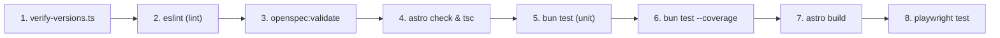

# Build rules and linters for internal CSS research (`allbugsarefixed-jaq.5`)

## Objective

Evaluate static analysis tools, linters, and build-time validation checks for internal CSS in this project.
Prevent contributors and automated agents from introducing inconsistent CSS properties, undeclared utility classes, and raw color literals.
Investigate Stylelint, ESLint CSS plugins, Lightning CSS integration in Vite, and zero-dependency build validation scripts.
Select a high-speed verification architecture that integrates into the existing Bun, ESLint, and CI workflows.

## Current linting and build architecture audit

The repository uses Astro 7.3+, Vite, React 19, and Bun 1.4.3.
Static analysis and verification run through several distinct stages in CI ([`.github/workflows/reusable-check.yml`](file:///home/mkobit/workspace/mkobit/allbugsarefixed/.github/workflows/reusable-check.yml#L1-L60)):



### Current CSS verification gaps

1. **Zero static validation for CSS files:**
   [`eslint.config.mjs`](file:///home/mkobit/workspace/mkobit/allbugsarefixed/eslint.config.mjs#L30-L35) targets `.js`, `.ts`, `.tsx`, `.astro`, and `.mdx` files.
   CSS files ([`src/styles/global.css`](file:///home/mkobit/workspace/mkobit/allbugsarefixed/src/styles/global.css), [`src/styles/shiki.css`](file:///home/mkobit/workspace/mkobit/allbugsarefixed/src/styles/shiki.css), and future `.module.css` files) receive no linting or syntax checks.

2. **Unenforced design token usage:**
   Developers can write raw hex colors (`#1e293b`), arbitrary Tailwind values (`bg-[#123456]`), or invalid CSS variables (`var(--non-existent)`).
   No automated check ensures that custom properties reference declared tokens in [`src/lib/tokens.gen.ts`](file:///home/mkobit/workspace/mkobit/allbugsarefixed/src/lib/tokens.gen.ts).

3. **Untyped CSS Modules class lookups:**
   When using `.module.css` files, typos in class names (`styles.missspelledButton`) evaluate to `undefined` at runtime without raising compile-time TypeScript errors.

4. **Supply chain and latency constraints:**
   The project configures `minimumReleaseAge` in `bunfig.toml` to reduce supply chain risks.
   Adding large npm dependency trees (such as Stylelint and multiple PostCSS plugins) increases package installation overhead and CI build times.

## Stylelint evaluation

Stylelint is the primary static analysis tool for standard CSS stylesheets.

### Package dependencies and configuration

To lint pure CSS, CSS Modules, and embedded Astro styles, Stylelint requires four packages:
- `stylelint`: Core lint engine and CLI runner.
- `stylelint-config-standard`: Recommended rules for standard CSS properties and syntax.
- `stylelint-config-html` (or `postcss-html`): Enables parsing of styles inside HTML and Astro `<style>` blocks.
- `stylelint-declaration-strict-value`: Enforces custom property usage (`var(...)`) for specific CSS properties such as `color`, `background-color`, and `border-color`.

### Stylelint configuration prototype (`.stylelintrc.json`)

```json
{
  "extends": [
    "stylelint-config-standard",
    "stylelint-config-html"
  ],
  "plugins": [
    "stylelint-declaration-strict-value"
  ],
  "rules": {
    "at-rule-no-unknown": [
      true,
      {
        "ignoreAtRules": [
          "theme",
          "utility",
          "plugin",
          "reference",
          "layer"
        ]
      }
    ],
    "selector-pseudo-class-no-unknown": [
      true,
      {
        "ignorePseudoClasses": [
          "global",
          "local"
        ]
      }
    ],
    "scale-unlimited/declaration-strict-value": [
      ["/color$/", "fill", "stroke"],
      {
        "ignoreValues": [
          "transparent",
          "currentColor",
          "inherit",
          "initial",
          "none"
        ]
      }
    ]
  }
}
```

### Stylelint limitations in this repository

1. **No verification against token single source of truth:**
   `stylelint-declaration-strict-value` verifies that a declaration uses `var(...)`.
   It cannot verify whether `--color-invalid-token` exists in [`src/lib/tokens.gen.ts`](file:///home/mkobit/workspace/mkobit/allbugsarefixed/src/lib/tokens.gen.ts) or [`src/styles/global.css`](file:///home/mkobit/workspace/mkobit/allbugsarefixed/src/styles/global.css).
   Developers can write typos (`var(--color-brand-bgg)`) that pass Stylelint without errors.

2. **Tailwind v4 syntax conflicts:**
   Tailwind CSS v4 introduces new at-rules (`@theme`, `@utility`, `@plugin`, `@reference`).
   Standard Stylelint rules flag these as unknown syntax unless developers maintain manual exception lists.

3. **Performance and dependency overhead:**
   Running Stylelint under Bun adds 400 ms to 800 ms per run due to PostCSS AST parsing.
   It pulls in more than 40 transitive npm packages.

## ESLint and CSS Modules evaluation

ESLint currently manages JavaScript, TypeScript, JSX, and Astro files through Flat Config ([`eslint.config.mjs`](file:///home/mkobit/workspace/mkobit/allbugsarefixed/eslint.config.mjs)).

### Detecting unused and missing CSS Module classes

When adopting CSS Modules for component styling (recommended in [`allbugsarefixed-jaq-1`](file:///home/mkobit/workspace/mkobit/allbugsarefixed/docs/research/allbugsarefixed-jaq-1-component-styling-and-variants.md)):
- `eslint-plugin-css-modules-next` or `@bhollis/eslint-plugin-css-modules` compares exported class names in `*.module.css` with property accesses on `styles.*` in JSX.
- It reports an error when a component accesses an undefined class name.
- It reports an error when a CSS class is defined but never used in the component.

### Banning raw colors and arbitrary values in JSX/TSX

We can enforce design tokens in JSX/TSX immediately using the standard `no-restricted-syntax` rule in [`eslint.config.mjs`](file:///home/mkobit/workspace/mkobit/allbugsarefixed/eslint.config.mjs).
This requires zero new npm packages.

#### Rule implementation prototype

```javascript
// Add to eslint.config.mjs under TypeScript/TSX file overrides:
{
  files: ['**/*.tsx', '**/*.jsx'],
  rules: {
    'no-restricted-syntax': [
      'error',
      {
        message: 'Raw hex color literals are prohibited in JSX/TSX. Use tokens from src/lib/tokens.gen.ts or CSS classes.',
        selector: 'Literal[value=/^#([0-9a-fA-F]{3}|[0-9a-fA-F]{4}|[0-9a-fA-F]{6}|[0-9a-fA-F]{8})$/]',
      },
      {
        message: 'Arbitrary hex values in class names are prohibited. Use design tokens.',
        selector: 'JSXAttribute[name.name="className"] Literal[value=/\\[#(?:[0-9a-fA-F]{3,8})\\]/]',
      },
    ],
  },
}
```

### ESLint CSS plugin (`@eslint/css`)

ESLint recently introduced `@eslint/css` as an official language plugin for CSS in Flat Config.
- Uses CSSTree parser.
- Checks CSS duplicate selectors, invalid properties, and Baseline compatibility (`css/use-baseline`).
- **Limitation:** Like Stylelint, it does not validate custom property names against project-specific TypeScript dictionaries.

## Lightning CSS and Vite pipeline evaluation

Lightning CSS is an extremely fast CSS parser, transformer, and minifier written in Rust.

### Built-in Vite integration

Vite supports Lightning CSS natively without extra build plugins:
```javascript
// astro.config.mjs
export default defineConfig({
  vite: {
    css: {
      transformer: 'lightningcss',
    },
    build: {
      cssMinify: 'lightningcss',
    },
  },
})
```

### Key capabilities

1. **Strict syntax error validation:**
   Lightning CSS parses CSS using Rust.
   Malformed declarations, missing braces, or invalid syntax trigger immediate build failures (`bun run build`).

2. **Dead-code elimination:**
   Automatically removes unused `@keyframes`, deduplicates identical rules, and minifies modern color functions (`oklch`, `color-mix`).

3. **Vendor prefixing and modern CSS lowering:**
   Uses `browserslist` targets to lower modern CSS features (such as CSS nesting and color-mix) for older target browsers.

### Interaction with Tailwind CSS v4

- Tailwind CSS v4 (`@tailwindcss/vite` active in [`astro.config.mjs#L4`](file:///home/mkobit/workspace/mkobit/allbugsarefixed/astro.config.mjs#L4)) already embeds Lightning CSS internally for stylesheet transformation.
- Activating `css.transformer: 'lightningcss'` globally in Vite while `@tailwindcss/vite` is present can cause redundant compilation passes.
- When Tailwind CSS is removed during the migration epic ([`allbugsarefixed-jaq`](file:///home/mkobit/workspace/mkobit/allbugsarefixed/docs/research/)), enabling Lightning CSS in Vite provides native CSS minification and syntax checks with zero runtime plugins.

## Custom build-time validation script (`scripts/verify-css.ts`)

A project-local script executed with Bun provides exact verification without third-party dependencies.

### Script architecture and verification capabilities

[`scripts/verify-css.ts`](file:///home/mkobit/workspace/mkobit/allbugsarefixed/scripts/) checks all `.css`, `.astro`, and `.module.css` files against project rules:

1. **Validate CSS custom property references:**
   Imports `tokenNames` directly from [`src/lib/tokens.gen.ts`](file:///home/mkobit/workspace/mkobit/allbugsarefixed/src/lib/tokens.gen.ts).
   Extracts all `var(--token-name)` expressions.
   Fails the build if any stylesheet references an undeclared CSS variable.

2. **Ban raw hex and rgb color values in component styles:**
   Scans for `#hex`, `rgb()`, `rgba()`, and `hsl()` patterns.
   Permits raw colors only within [`src/styles/global.css`](file:///home/mkobit/workspace/mkobit/allbugsarefixed/src/styles/global.css) token definition blocks.
   Fails if raw color literals appear in component stylesheets or `.astro` files.

3. **Validate CSS Module class references:**
   Scans TypeScript imports of `.module.css` files and flags missing selectors.

4. **Execution speed:**
   Executes in under 20 ms in Bun.
   Requires zero npm dependencies.
   Runs automatically in `bun run verify:css` and `mise run check`.

### Prototype implementation (`scripts/verify-css.ts`)

```typescript
import { readFileSync, globSync } from 'node:fs'
import { tokenNames } from '../src/lib/tokens.gen'

interface TokenViolation {
  readonly file: string
  readonly line: number
  readonly message: string
}

const declaredTokens = new Set<string>(Object.values(tokenNames))
const cssFiles = globSync('src/**/*.{css,astro}')

const HEX_COLOR_REGEX = /#(?:[0-9a-fA-F]{3,8})\b/g
const CSS_VAR_REGEX = /var\(\s*(--[a-zA-Z0-9_-]+)/g

const violations: TokenViolation[] = []

for (const filePath of cssFiles) {
  const content = readFileSync(filePath, 'utf8')
  const lines = content.split('\n')

  lines.forEach((lineText, index) => {
    const lineNumber = index + 1

    // Skip comments and allowed token definitions in global.css
    if (lineText.trim().startsWith('/*') || lineText.includes('//')) return

    // 1. Check CSS custom property references
    for (const match of lineText.matchAll(CSS_VAR_REGEX)) {
      const varName = match[1]
      // Allow private component variables prefixed with --_
      if (varName.startsWith('--_')) continue

      if (!declaredTokens.has(varName)) {
        violations.push({
          file: filePath,
          line: lineNumber,
          message: `Undeclared CSS token "${varName}". Add to src/styles/global.css and run "bun run tokens:generate".`,
        })
      }
    }

    // 2. Check forbidden raw hex colors outside global.css
    if (!filePath.endsWith('src/styles/global.css')) {
      for (const match of lineText.matchAll(HEX_COLOR_REGEX)) {
        violations.push({
          file: filePath,
          line: lineNumber,
          message: `Forbidden raw hex color "${match[0]}". Use a design token var(--...) from src/lib/tokens.gen.ts.`,
        })
      }
    }
  })
}

if (violations.length > 0) {
  console.error(`Found ${violations.length} CSS verification violations:`)
  violations.forEach(v => console.error(`  ${v.file}:${v.line} - ${v.message}`))
  process.exit(1)
}

console.log(`Verified CSS across ${cssFiles.length} files. Zero violations.`)
```

## Comparative analysis of static analysis tools

| Evaluation criteria | Stylelint | ESLint (`@eslint/css`) | Lightning CSS | Custom script (`verify-css.ts`) |
| :--- | :--- | :--- | :--- | :--- |
| **Enforce exact tokens from `tokens.gen.ts`** | No | No | No | **Yes (exact match)** |
| **Ban raw hex/rgb in stylesheets** | Yes (`strict-value`) | No | No | **Yes (strict regex)** |
| **Ban raw hex/rgb in JSX/TSX** | No | **Yes (`no-restricted-syntax`)** | No | Can be extended |
| **Catch unused CSS Module classes** | No | **Yes (`css-modules-next`)** | No | No |
| **Catch invalid CSS syntax** | Yes | Partial | **Yes (Rust compiler)** | Basic checks |
| **Execution speed** | ~500 ms | Included in `lint` | Included in `build` | **<20 ms** |
| **New dependencies required** | 4–6 npm packages | 1 npm package | 0 (built into Vite) | **0 packages** |
| **Supply chain risk** | Moderate | Low | None | **None** |

## Implementation specifications and prototypes

### 1. `package.json` script updates

Add `verify:css` to the existing verification suite:

```json
{
  "scripts": {
    "verify": "bun run verify:versions && bun run verify:blog && bun run verify:css",
    "verify:css": "bun scripts/verify-css.ts",
    "tokens:check": "bun scripts/generate-tokens.ts --check"
  }
}
```

### 2. Integration into CI pipeline

Update [.github/workflows/reusable-check.yml](file:///home/mkobit/workspace/mkobit/allbugsarefixed/.github/workflows/reusable-check.yml) and `mise.toml` to execute `bun run verify:css` as part of the check suite.

## Phased adoption recommendations

### Phase 1: High-speed, zero-dependency validation (Immediate)

1. **Deploy `scripts/verify-css.ts`:**
   Implement the lightweight verification script to check token references against [`src/lib/tokens.gen.ts`](file:///home/mkobit/workspace/mkobit/allbugsarefixed/src/lib/tokens.gen.ts).
   Add `verify:css` to `package.json` and CI checks.
2. **Add `no-restricted-syntax` to `eslint.config.mjs`:**
   Prohibit raw hex colors in JSX and TSX files.
   Provides instant visual feedback in VS Code and other editors.

### Phase 2: CSS Modules linting (During component migration)

1. **Add `eslint-plugin-css-modules-next`:**
   When converting components from Tailwind utility classes to `.module.css` files, add the CSS Modules ESLint plugin to flag unused classes and class name typos in JSX.
2. **Enable typed CSS modules:**
   Configure `typescript-plugin-css-modules` or generate `*.module.css.d.ts` definitions to enable compile-time TypeScript autocompletion for class names.

### Phase 3: Lightning CSS compiler activation (Post-Tailwind)

1. **Configure Lightning CSS in Vite:**
   Once `@tailwindcss/vite` is fully removed, enable `css.transformer: 'lightningcss'` and `build.cssMinify: 'lightningcss'` in [`astro.config.mjs`](file:///home/mkobit/workspace/mkobit/allbugsarefixed/astro.config.mjs).
   Provides fast syntax validation, lowering, and dead-code elimination with zero extra runtime plugins.

### Recommended beads task breakdown

- `allbugsarefixed-jaq.5.1`: Implement `scripts/verify-css.ts` and add `bun run verify:css` to `package.json` and CI.
- `allbugsarefixed-jaq.5.2`: Add `no-restricted-syntax` rules in `eslint.config.mjs` to ban raw hex literals in JSX/TSX.
- `allbugsarefixed-jaq.5.3`: Integrate CSS Modules class name validation when migrating the first component.

## References

- [Stylelint Official Documentation](https://stylelint.io/)
- [Lightning CSS Documentation and Vite Integration](https://lightningcss.dev/)
- [ESLint Custom Selectors and AST Queries](https://eslint.org/docs/latest/extend/selectors)
- [Design Token Architecture Research: `allbugsarefixed-jaq-3`](file:///home/mkobit/workspace/mkobit/allbugsarefixed/docs/research/allbugsarefixed-jaq-3-token-architecture-and-theme-switching.md)
- [Component Styling Research: `allbugsarefixed-jaq-1`](file:///home/mkobit/workspace/mkobit/allbugsarefixed/docs/research/allbugsarefixed-jaq-1-component-styling-and-variants.md)
- [Modern Layouts Research: `allbugsarefixed-jaq-4`](file:///home/mkobit/workspace/mkobit/allbugsarefixed/docs/research/allbugsarefixed-jaq-4-layouts-and-widgets.md)

### Modern Web Guidance

- Checked `css` in `modern-web-guidance` regarding static analysis and cascade layers.
  No external guidance guides specifically cover CSS linter configuration or build verification scripts.
